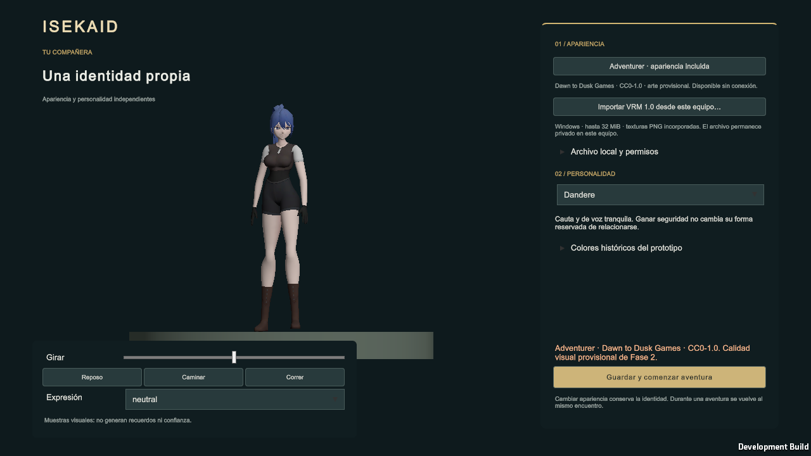
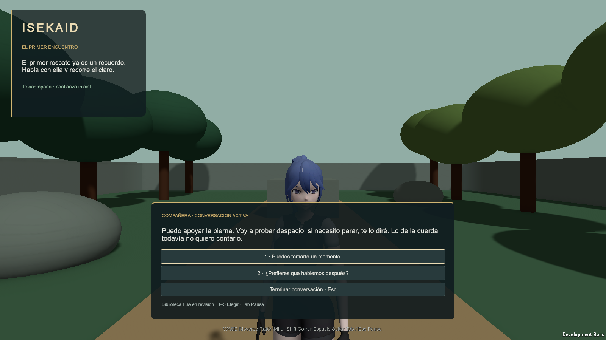
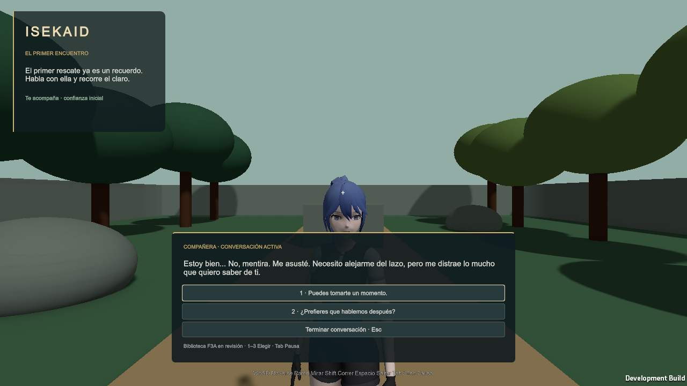
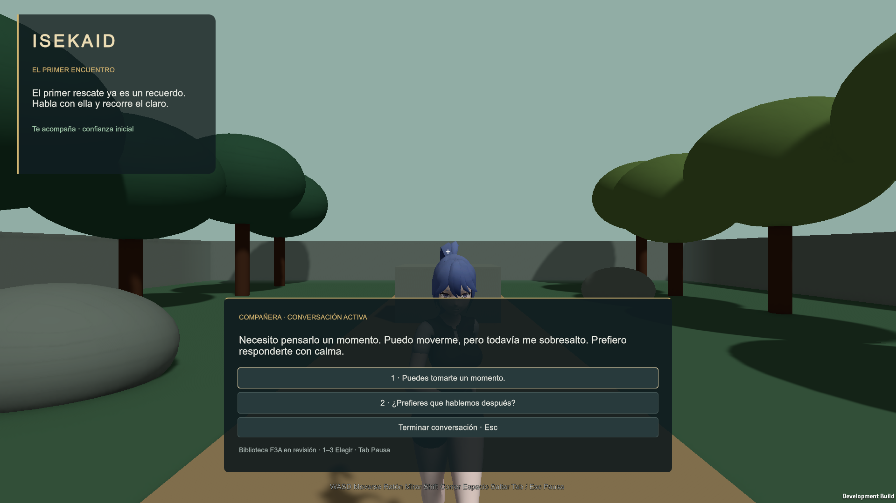

# ISEKAID — N1 v0.5, entrega experimental de Chat 3

Fecha: 29/10/2026. **Estado: entrega técnica disponible para revisión; aceptación creativa/manual de Dirección pendiente.** No se declara N1 aceptado definitivamente.

## Resultado y procedencia

Se integraron exclusivamente los 30 cambios autorizados de `recommended.spokenText` y `recommended.intention`, y se cambió la etiqueta visible del creador a **Dandere**. Se conservan las otras 30 entradas completas, los tres `E.DOWNED`, los 60 IDs y su orden, las 18 alternativas, condiciones, opciones, eventos, efectos, prioridades y cooldowns. Se regeneró el recurso runtime usando el generador existente. No se implementó N2 ni se agregaron gestores.

Rama nueva `feature/isek-f3a-n1-editorial-v05`, creada desde main `0ef11e552178ad2daf52293d7c32f4cdd1f80ea6`, fusión del PR #15. Implementación y pruebas: commit `68f816b5dca76aa1585041dc5ddca5a8d153ded6`; el commit posterior añade informe/evidencia sin modificar Unity. GDD maestro v0.7 conservado.

Fuente única: [PR #14, archivo v0.5 en el commit aprobado](https://github.com/MarcoPolo2-0/Isekaid/blob/5bdfeed43994e509f48dde148beca50dc961278f/Documentation/Specifications/F3A-N1/17_Parche_Editorial_v0.5_PROPUESTA.json). Se comprobó por Git y API que el PR apuntaba a `5bdfeed43994e509f48dde148beca50dc961278f`, seguía abierto y sin fusionar. La autorización experimental por los 30 IDs procede de la instrucción directa posterior de Dirección; el estado editorial dentro del JSON se conserva como evidencia histórica, sin reescribirlo. No se fusionó #14, ni se aplicaron v0.2/v0.3/v0.4 secuencialmente.

| Comprobación de origen | Resultado verificado antes de aplicar |
|---|---|
| Commit base del parche / main al inicio | `0ef11e552178ad2daf52293d7c32f4cdd1f80ea6` |
| Blob del parche aprobado | `77228337ac434b4a56a47e25f05219e6c1ceffe7` |
| Blob de la canónica base | `2931044800a500bbcefe184b15c27ae516c393e7` |
| SHA-256 canónica UTF-8/LF base | `e475943e9a9eaab1787277a8257d111af21c7ff8509bef5f8145b3e3fc4f214e` |
| Valores `expected` | Coinciden en las 33 revisiones; tres descartadas sin edición |
| Procedencia de propuesta anterior | Blob y SHA-256 LF comprobados; no aplicada |

[manifest.json](manifest.json) enumera los **30 IDs exactos y los campos efectivamente modificados**, la base y los hashes finales. [Parche_Autorizado_v0.5.json](Parche_Autorizado_v0.5.json) conserva los bytes del blob aprobado. Los 30 cambios modifican texto e intención; ninguna revisión aporta otros campos a la biblioteca.

Canónica nueva: `4754a2c8a1526e82356ba45fd6ff82b333ea9293e80dbcb49fc50a6d89e80b39`. Recurso runtime: `eafcb8dacd4f466a913630b52d54813d5c54ba4899aac0d25cd5ef7efef51eee`.

## Alcance de archivos y compatibilidad

- [Biblioteca canónica](../../Specifications/F3A_Biblioteca_v0.1.json) y [recurso runtime generado](../../../UnityProjectIsekaid/Assets/_Project/Resources/Dialogue/F3A.es.json): solo texto/intención de los IDs autorizados y hash de procedencia del recurso generado.
- [CompanionPalette](../../../UnityProjectIsekaid/Assets/_Project/Scripts/Companion/CompanionPalette.cs): una etiqueta, Tímida → Dandere. `CompanionPersonality.Shy=2`, `shy`, `F3A.SHY.*`, tres opciones y esquemas v1/v2 intactos. Sin migración nueva.
- [Generador](../../../tools/build_f3a_runtime_content.py): `newline="\n"` al escribir; [.gitattributes](../../../.gitattributes) fija LF únicamente para canónica, runtime y evidencia JSON de esta entrega. UTF-8 sin BOM y normalización exclusiva de CRLF/CR a LF para comparar hashes; no se omiten `expected` ni se normalizan palabras/espacios. El generador `--check` sigue activo.
- [Verificador N1](../../../tools/verify_f3a_n1.py): reconstruye el candidato esperado desde el blob base y la copia fijada del parche; compara **toda** la estructura, el runtime y el manifiesto. Rechaza siete casos adversarios: hash, expected, ID ajeno, duplicado, campo adicional, activación de DESCARTAR y blob base incorrecto. Comprueba equivalencia CRLF/LF y exige archivos de entrega LF.
- Se ampliaron exclusivamente las comprobaciones existentes [F2IntegrationChecks](../../../UnityProjectIsekaid/Assets/_Project/Editor/F2IntegrationChecks.cs), [F2RuntimeChecks](../../../UnityProjectIsekaid/Assets/_Project/Validation/F2RuntimeChecks.cs) y [F3ARuntimeChecks](../../../UnityProjectIsekaid/Assets/_Project/Validation/F3ARuntimeChecks.cs). No son nuevos componentes de gameplay. Las pruebas comprueban el Dropdown real, perfiles anteriores, reinicio y FEEL de las tres personalidades en las tres resoluciones. El diagnóstico de límites ahora incluye los rectángulos al fallar; la condición no se relajó.
- Informe, manifiestos, resultados, guía, capturas y readme aditivo. El análisis técnico N1/N2 anterior permanece intacto en [PR #14](https://github.com/MarcoPolo2-0/Isekaid/blob/5bdfeed43994e509f48dde148beca50dc961278f/Documentation/Audits/F3A-N1-N2/Impacto_Tecnico_Chat3_v0.1.md); sus recomendaciones v0.2 quedan históricas frente a esta autorización v0.5.

Se compararon los archivos Unity con main: **solo cinco archivos Unity modificados**, el recurso runtime, CompanionPalette y las tres comprobaciones. Escenas, prefabs, `.meta`/GUIDs, perfil/store, importador VRM, supervivencia, locomoción, shaders/materiales, paquetes, configuración y GDD oficial sin cambios. No hay referencias nuevas de Inspector ni wiring que configurar. Los dos assets URP reserializados automáticamente durante el build se inspeccionaron y restauraron a sus bytes de origen; no forman parte de la entrega.

## Pruebas ejecutadas

Unity **6000.6.7f1**, Windows, datos nuevos aislados, proyecto real. Editor y build ejecutados secuencialmente; Windows en ventana visible. Los escenarios F3A/presentación conservan su límite de 60 FPS. [Resumen verificable](results/summary.json).

| Prueba | Resultado de esta entrega | Evidencia |
|---|---|---|
| N1, generador `--check`, estructura unificada | PASS; 30 modificadas/30 intactas, 60 IDs/18 alternativas; siete rechazos | Verificador reproducible y manifiesto |
| Protección F2 | PASS, 715 originales protegidos | `verify_vrm_f2_delivery.py` |
| F3A Play Mode | PASS, **330 comprobaciones / 18 rutas** | [Editor](results/editor-f3a.json) |
| F3A Windows | PASS, **330 comprobaciones / 18 rutas** | [Windows](results/windows-f3a.json) |
| F2 catálogo/VRM, cambios y rollback | PASS, **46 Editor / 39 Windows** | [Editor](results/editor-f2.json), [Windows](results/windows-f2.json) |
| Perfiles anteriores y recuperación | PASS, **14 aserciones**; v1/v2 Shy=2, identidad, relectura, respaldo y fallos de escritura | [Almacenamiento](results/storage-results.json) |
| Reinicio real de Windows | PASS, **4 comprobaciones**; Dandere/Shy=2, VRM gestionado sin origen | [Reinicio](results/windows-restart.json) |
| Comparación de perfiles antes/después de proceso | PASS: misma identidad, apariencia, formato 2 y personalidad 2; perfiles privados no publicados | [Resumen de persistencia](results/restart-persistence.json) |
| Guardas VRM | PASS, 9 rechazos y 2 límites de archivo | [Guardas](results/guard-results.json) |
| Metadatos/persistencia adversaria | PASS, **35 aserciones**, límites 32 KiB/1 MiB | [Metadatos](results/metadata-results.json) |
| Prototipo / dos escenas | Marcadores PROTOTYPE y TWO_SCENE_PLAYMODE_CHECKS_PASSED en la ejecución de guardas | [Notas del motor](results/engine-notes.json) |
| Locomoción de catálogo y VRM | PASS, **6 movimientos / 4 secuencias por plataforma** | [Editor](results/editor-presentation.json), [Windows](results/windows-presentation.json) |
| UI responsiva | Creador y conversación en **1920×1080 / 1600×900 / 1280×720**; límites/textos/opciones comprobados en F3A y capturas reales | [Inventario de capturas](results/capture-inventory.json) |
| Compilación Windows | **Succeeded**, Development x64, 196472216 bytes | [Build y hashes](results/build-results.json) |

Las 18 rutas se recorren de forma independiente. F3A prueba cierre voluntario, reapertura/foco, pausa, cambio de apariencia vía creador con cursor pendiente, VRM y catálogo, dos episodios Downed/reanimación, prioridad de supervivencia, muerte y reinicio. El temporizador conserva 30 segundos; las pruebas de estado comprueban 29 segundos/1 restante y agotamiento, y Play Mode comprueba pausa y evolución usando tiempo escalado para acelerar el ensayo. No se promete cronometraje humano de 30 segundos reales.

Locomoción registra cero reinicios de tiempo y cero alternancias rápidas en los cuatro casos de cada plataforma. El ruido 2.96↔3.04 m/s produce 72–74 cruces medidos y solo dos cambios de estado de entrada/salida; no se tocaron los controladores. Esto no certifica arte final, ausencia completa de deslizamiento, todos los avatares ni sesiones prolongadas. Los registros de Windows comprobados no contienen marcadores de errores/excepciones/asserts; F3A informa `engineErrors=[]` en ambas plataformas.

## Evidencia visual y privacidad

Las **13 PNG** publicadas son capturas reales de la build Windows visible, copiadas sin edición: nueve raíces FEEL (tres personalidades × tres resoluciones), tres del creador y una de Run. Cada imagen tiene dimensiones/hash y procedencia en el inventario. Se inspeccionaron muestras representativas del creador, Tsundere, Yandere, Dandere y locomoción, y se comprobó que las 13 imágenes no fueran negras/vacías. Los límites automatizados complementan la inspección; no sustituyen la prueba humana de todos los textos.

Adventurer es arte provisional de Dawn to Dusk Games, CC0-1.0; [licencia y procedencia incluidas](../../../UnityProjectIsekaid/Assets/_Project/AvatarCatalog.LICENSE.txt). No se publica el VRM privado, sus capturas, perfiles, copia gestionada ni material extraído. Se comprobaron intactos los hashes del fixture original autorizado y del fixture local de metadatos grandes. Resultados numéricos, hashes y registros de pruebas no conceden derechos sobre el modelo.

## Limitaciones e incidencias conservadas

1. [Primer intento Editor fallido](results/editor-f3a-initial-failed.json): 30 comprobaciones, antes de completar una ruta, fallo de límites del panel al cambiar a 1600. Las capturas disponibles parecían dentro del viewport. No se atribuye una causa demostrada: las primeras invocaciones no esperaban correctamente el proceso y hubo reintentos; se corrigió la forma de ejecución/espera, se añadió diagnóstico a la misma aserción y la ejecución aislada Editor y la build Windows pasaron sin modificar UI. Conservar el fallo permite revisar si reaparece durante la prueba manual.
2. Advertencias internas del buscador/Hierarchy del Editor y de AudioListener durante cargas aditivas, además de avisos existentes de macros en `.gitattributes` anidado. Se conservan notas por ejecución, sin corregir sistemas ajenos ni desactivar validaciones nuevas. Las exclusiones ya existentes del buscador en los harness no se ampliaron.
3. Entrada automatizada por teclado/eventos UI; no se afirma prueba física del ratón, captura del cursor ni selector nativo en esta entrega. Los 30 textos tienen comparación exacta estática; no se asegura que todos hayan sido leídos y aprobados por una persona en pantalla. La nueva inspección responsiva dirigida a FEEL no equivale a explorar todas las cadenas posibles ni todas las relaciones de aspecto.
4. F3A-D08/R10/R11, VRM-AC01/12/22/24 y LOC-05/REN-04 no se declaran cerrados globalmente por estas regresiones. N1 requiere revisión manual; ritmo/gestos/mirada y aceptación corporal pertenecen a N2 u otras puertas. No se incorporan nombres Nera/Liora/Sira, biografías, proyectos, Deredere, romance, promesas, memoria avanzada ni nuevas mecánicas.
5. No se generó un instalador ni se probó otra plataforma/Unity. La build local permite la revisión Windows; no se distribuye junto al VRM privado. Los logs completos, CSV y capturas privadas permanecen bajo `UnityProjectIsekaid/LocalVrmEvidence/N1/`, excluido de Git.

## Estado por criterio y siguiente revisión

[criterios.json](criterios.json) separa comprobaciones técnicas PASS de aceptación manual PENDIENTE. El dictamen es **APTO PARA REVISIÓN EXPERIMENTAL DE DIRECCIÓN**, sin fusión automática ni aceptación definitiva de N1.

La [guía manual](PRUEBA_MANUAL.md) permite repetir los 18 recorridos, leer los diez IDs por personalidad, comprobar Dandere/perfiles, continuidad, incapacidad/reanimación, VRM, seguimiento y UI. Dirección debe decidir si acepta las voces y su contextualización dentro de Unity. N2 continúa fuera de alcance.
