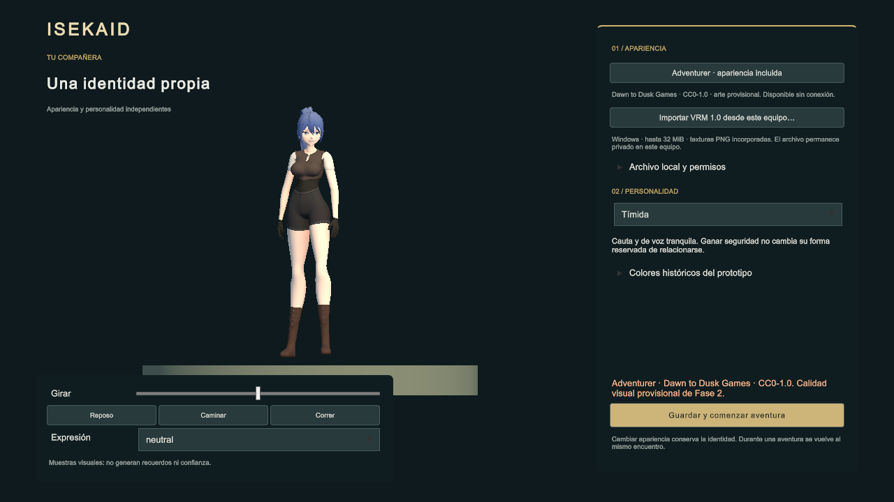
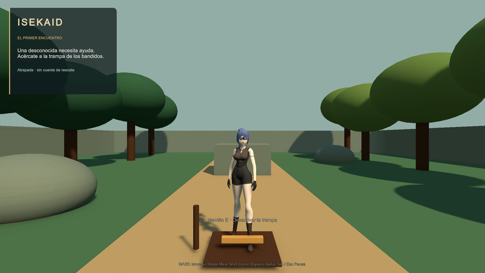

# ISEKAID — F2: creador de compañera y apariencia VRM

**Fecha:** 28/10/2026, Guatemala. **Unity:** 6000.6.7f1. **Rama:** `feature/isek-vrm-f2-character-creator`.
**Base:** `main` 480a8e9, con PR #3 y #4 incorporados. **Estado:** entrega experimental para revisión de Dirección; no fusionar ni iniciar F3.

**Revisión posterior de Dirección:** [corrección del presupuesto de metadatos, roundtrip y pruebas](metadata-review/INFORME.md). Incluye la documentación del PR #6, sin fusionar main. Los resultados del cuerpo de este informe conservan la entrega inicial.

## 1. Resultado y alcance

El creador permite elegir Adventurer, importar un VRM 1.0 local, girar la vista previa, probar animaciones y expresiones, seleccionar una de las tres personalidades, guardar y entrar a Game. La apariencia se carga mediante el importador transaccional existente; se conservan su validación, sus GUID y el controlador de compañera del prototipo.

Al volver al creador desde Game se conserva el mismo encuentro en pausa. Se mantienen la instancia de `CompanionController`, su `CompanionState`, confianza, recuerdo del primer rescate, posición y reglas de movimiento. Al regresar se restauran cámaras, luces, audio y HUD. El cambio se bloquea mientras la compañera está incapacitada o muerta. No existe todavía un sistema completo de combate, secuestro, misiones o memoria narrativa sobre el cual acreditar los casos futuros.

No se modifican Woman, G2-PROTO, G2-CORR ni los prefabs originales. Se verifican 715 archivos protegidos sin cambios de contenido; también se conservan los archivos `.meta` de las escenas. Las dos escenas autorizadas reciben referencias al catálogo y al controlador visual; CharacterCreation ajusta cámara y capa de vista previa. `CompanionPrototype.unity` permanece como escena histórica.

## 2. Implementación

- `AvatarRuntime/`: se traslada el importador de PR #4 conservando ensamblado, espacio de nombres y GUID. Se añaden cancelación, selección por hash, validación de metadatos y selector nativo Windows. No se añade otra dependencia de importación ni un segundo controlador de personalidad.
- `CompanionAppearance`: conserva las referencias de colores antiguas y coordina catálogo, VRM y muestras visuales. Los tintes históricos no se aplican a texturas o índices de morphs ajenos. Los colliders del VRM se desactivan; navegación e interacción siguen usando el actor original.
- `CharacterCreationController`: mantiene UI Toolkit y el estilo del prototipo. El botón de continuar permanece visible; permisos y colores históricos se despliegan aparte. Una cancelación o error conserva la apariencia válida previa.
- `CompanionPrototype`: abre el creador de forma aditiva en pausa y vuelve al mismo encuentro. Oculta el documento del HUD sin destruir su árbol visual.
- `GraphicsSettings`: conserva MToon URP y UniUnlit en la build para que la carga dinámica no dependa de shaders ausentes. Unity añade sus campos de serialización actuales al guardar estos ajustes.

### Persistencia y recuperación

El perfil v2 separa identidad y personalidad de `appearance`. El archivo contiene versión, checksum y respaldo; se escribe mediante temporal, vaciado y reemplazo del archivo. El perfil v1 de PlayerPrefs permanece intacto y su JSON original se conserva, incluidos campos desconocidos. El fixture estructurado de migración incluye memoria y clase; esto prueba conservación de datos, no implementación de esos sistemas.

Los VRM confirmados se copian a `Application.persistentDataPath/Companion/Avatars/<sha256>.vrm`. La selección conserva hash, versión VRM, metadatos y declaración de uso local; no guarda la ruta original ni depende de ella. Antes de cargar una copia se comprueba su hash. Si falta o está dañada, se muestra Adventurer con aviso y se conserva la referencia guardada para reimportación o confirmación explícita de recuperación.

No hay borrado automático de la biblioteca ni limpieza de copias sin referencia: evita eliminar recursos de otros perfiles o respaldos, pero puede dejar archivos huérfanos tras fallos de guardado. El encuentro conserva su memoria durante la edición; **el guardado completo de la aventura entre ejecuciones no forma parte de esta entrega** y no existía en el prototipo.

### Recursos y cancelación

Se identificó una fuga nativa de buffers de colas en el combinador compartido de Spring Bones al retirar avatares. Se utiliza `Vrm10FastSpringboneRuntimeStandalone`, disponible en el SDK fijado, sin parchear el paquete. La repetición posterior con detección de fugas activada no produjo ese aviso.

La carga mantiene oculto el candidato mientras se prepara y se evalúa el rig; su contenedor visual permite ajustar altura y apoyo sin alterar el actor. Se valida y activa antes de retirar la apariencia anterior. El token llega al SDK y se comprueba antes de publicar el candidato. Esto no permite interrumpir arbitrariamente una decodificación nativa síncrona.

El ensayo fuera del Editor detectó un desbordamiento de pila al transferir un StringBuilder grande al selector Win32. Se sustituyó por un buffer en memoria no administrada, liberado en `finally`. Las pruebas de seleccionar y cancelar utilizan diálogos reales del ejecutable; el helper solo actúa sobre el proceso de prueba indicado.

## 3. Licencias y privacidad

**Catálogo incluido:** Adventurer Outfit 02, Dawn to Dusk Games, versión local 1.2. La [página del autor](https://dawn-to-dusk-games.itch.io/3d-anime-female-adventurer) publica CC0-1.0. Se reutilizan malla, texturas y clips Unarmed Idle/Walk/Run ya presentes; no se reconstruye el personaje. La procedencia y hashes originales están en `SourceReceipt.json`. El arte del catálogo es provisional y no constituye aprobación artística de F4.

**SDK:** UniVRM/UniGLTF 0.131.4, mismas dependencias fijadas en PR #4. Se conservan los avisos MIT de [UniVRM 0.131.4](https://github.com/vrm-c/UniVRM/blob/v0.131.4/LICENSE.txt) y UniGLTF, también en el paquete Windows. No se contrata ni invoca un servicio generativo o de pago.

**Fixture privado:** el hash utilizado está en los resultados, sin publicar el archivo ni sus imágenes. Declara `onlyAuthor`, `personalNonProfit`, créditos requeridos, modificación prohibida y redistribución no permitida. La UI muestra estos datos por separado de la declaración humana de autoría o permiso adicional. Compatibilidad técnica y marcar una casilla no verifican derechos sobre los recursos incorporados ni autorizan redistribución.

Las capturas del VRM permanecen en `UnityProjectIsekaid/LocalVrmEvidence/F2/`, excluidas de Git. Las imágenes públicas de este informe muestran únicamente el catálogo CC0. No se incorporan modelos privados a la build.

## 4. Pruebas y evidencia

Antes de modificar se respaldaron las dos escenas y se tomaron hashes de 797 archivos. La comprobación estática inicial del prototipo pasó. El primer Play Mode se interrumpió por `UnityEditor.Search.SearchDatabase`; se registró su stack y se excluye únicamente ese fallo del índice del Editor en la regresión. No se excluyen errores del gameplay.

Los resultados finales y su alcance se registran en los JSON adjuntos. Una prueba automatizada que manipula APIs del creador no acredita por sí sola cada clic de UI; el selector nativo se comprueba además mediante sus diálogos reales.

| Comprobación | Evidencia |
|---|---|
| Catálogo y VRM: creador → Game; tres personalidades independientes | `editor-results.json`, `windows-results.json` |
| Misma compañera, confianza y primer rescate durante cambios visuales | Aserciones sobre la misma instancia de estado y controlador |
| Cancelación antes y durante carga; solicitudes consecutivas | Aserciones de conservación del avatar anterior |
| Fallos en cinco etapas: bytes, importación, preparación, activación y ocultación anterior | Inyección en Editor; rollback verificado |
| Guardado fallido, migración v1 y recuperación de respaldo | `storage-results.json` |
| Copia gestionada dañada/perdida y archivo fuente borrado | Recorrido integrado; referencia y estado conservados |
| Cargas y descargas repetidas | Tres ciclos; 195 recursos propios destruidos comprobados por ejecución |
| Selector nativo: seleccionar y cancelar | Ejecutable Windows y helper limitado al proceso de pruebas |
| Reinicio real sin archivo fuente | Segundo proceso; `restart-results.json` |
| Rechazos y regresión del prototipo | `guard-results.json` (nueve fixtures y dos archivos locales), `regression-results.json` |
| Rutas, exclusiones y originales protegidos | `tools/verify_unified_layout.py`, `tools/verify_vrm_f2_delivery.py` |
| UI 1920×1080, 1280×720 y 1600×900 | Capturas reales del creador; revisión visual local |

### Expresiones y animaciones

El fixture conserva los canales comprobados en la auditoría previa: `happy`, `angry`, `sad`, `relaxed`, `surprised`, `aa`, `ih`, `ou`, `ee`, `oh`, `blink`, `blinkLeft`, `blinkRight`, `lookUp`, `lookDown`, `lookLeft`, `lookRight`, `neutral`. F2 vuelve a solicitar los canales disponibles y comprueba una petición inexistente sin error. Esto no acredita sincronización de labios ni conducta narrativa profunda.

Adventurer tiene 16 Shape Keys inspeccionadas. Las muestras se mapean por nombre a sonrisa, tristeza, sorpresa, parpadeo y apertura de boca; angry/relaxed vuelven a neutral por falta de un canal adecuado. Se reutilizan sus clips Generic. El VRM usa las animaciones Humanoid diagnósticas de PR #4; no se presentan como locomoción artística final.

### Rendimiento

Build Windows: 196,441,782 bytes según BuildPipeline, Development Mono, D3D11; equipo de prueba con NVIDIA GeForce RTX 5070 Ti. Editor: 638.2 ms de importador y 1.78 ms de intervalo medio. Windows: 518.4 ms y 1.61 ms; memoria asignada de 209.89 a 204.34 MiB tras los ciclos. El tiempo del importador no incluye todas las lecturas previas del creador. Las ventanas de ensayo no representan una sesión de usuario ni permiten deducir un objetivo de FPS. Se mide tiempo de importación, intervalo de 60 frames y memoria asignada por Unity antes/después de los ciclos. No es un perfil GPU completo ni una garantía para hardware mínimo. La primera captura del ejecutable durante arranque puede preceder al dibujo completo; no se usa como aprobación visual del catálogo.

## 5. Criterios F2 de la especificación v0.2

| Criterio | Estado | Alcance comprobado / pendiente |
|---|---|---|
| VRM-AC01 | PARTIAL | Catálogo único incorporado y ejecutable local sin cuenta ni descarga. No se desconectó físicamente la red durante este ensayo. |
| VRM-AC04 | PASS | Cancelación, peticiones consecutivas y diálogo nativo; el candidato cancelado no sustituye al anterior. |
| VRM-AC12 | PARTIAL | Identidad, personalidad, datos legacy y estado real existente conservados. Clase, misiones y rasgos evolucionados aún no existen funcionalmente; no se acredita F3. |
| VRM-AC13 | PASS | Error de guardado inyectado y fallo real de reemplazo de archivo bloqueado; original y respaldo recuperables. No se ensayó corte eléctrico real. |
| VRM-AC14 | PASS | Copia gestionada comprobada tras borrar el archivo fuente y reiniciar el ejecutable. |
| VRM-AC15 | PASS | Copia dañada/perdida: fallback anunciado, referencia y memoria del encuentro conservadas; reimportación recupera el recurso. |
| VRM-AC16 | PASS | Migración v1 con colores, personalidad y JSON desconocido preservados; respaldo y error de guardado comprobados. |
| VRM-AC17 | PASS | Restricciones reales y fixture con créditos mostrados por separado de la declaración humana. Revisión de derechos pendiente; no equivale a permiso legal validado. |
| VRM-AC22 | PARTIAL | Copias por hash y respaldos preservados. No se implementa eliminación de biblioteca ni se acredita compatibilidad con formatos futuros de partida. |
| VRM-AC24 | PARTIAL | Edición bloqueada en incapacitación/muerte y encuentro pausado conservado. Combate, secuestro y secuencias importantes requieren sistemas y pruebas posteriores. |
| VRM-AC26 | PASS | Muestras sin controlador de compañera propio; no modifican confianza, rescates ni estado del encuentro conservado. |

Estos estados quedan sujetos a los resultados finales adjuntos y revisión de Dirección. No se declara aprobación artística ni cierre de F3/F4.

Los archivos `native-picker-results.json` conservan el recorrido con diálogos de la build previa; el selector no cambió en la build final. `windows-results.json` y `restart-results.json` corresponden al recorrido y reinicio del código final. El cambio posterior de empaquetado solo añade avisos de licencia y se comprobó con un nuevo reinicio.

## 6. Limitaciones

- Plataforma verificada: Windows; selector en Windows Editor/Player. No se promete soporte móvil, macOS, Linux o WebGL.
- Límites heredados: 32 MiB, VRM 1.0, GLB con recursos incorporados, PNG hasta 4096 por lado y presupuesto total de píxeles; límites adicionales de nodos, geometría y Spring Bones. JPEG, VRM 0.x y recursos externos se rechazan en este prototipo.
- La importación ocurre en el proceso de Unity. Los límites y nueve rechazos no constituyen aislamiento de seguridad ni defensa completa frente a archivos hostiles. No se ejecuta código del avatar ni se aceptan URI externas.
- No se realizó captura de tráfico que acredite cero solicitudes de red del ejecutable. La build de desarrollo incluye la infraestructura de diagnóstico de Unity. VRM-AC18 no se acepta por inferencia del código.
- No hay presupuesto de rendimiento/hardware ni intervalos artísticos aprobados para aceptar completamente VRM-AC19/20. El ajuste visual mantiene el actor y su hitbox, pero no acredita todos los rigs, materiales o accesorios posibles.
- La iluminación MToon del fixture muestra zonas claras muy intensas. Requiere revisión artística; no se han alterado sus texturas ni se certifica fidelidad a VRoid.
- No se acredita guardado global de aventura, personalidad evolutiva, combate, clases, misiones, secuestro, lip sync ni catálogo final de tres personajes.
- El índice de búsqueda del Editor falla en este entorno; el primer importado también registró un fallo de TMP de UGameStudio ya presente antes de la integración. No se corrigen dependencias ajenas como parte de F2.

## 7. Reproducción y revisión

Consultar `PRUEBAS.md` para comandos y pasos manuales. Los datos y capturas de pruebas deben ir a directorios privados fuera de Git; el fixture se proporciona localmente, nunca como recurso del proyecto. No ejecutar builders históricos sobre las escenas aceptadas: el ajuste de F2 es `AvatarIntegrationBuilder.Run` y requiere conservar versiones recuperables.

Dirección debe revisar la calidad visual, la experiencia del creador, las restricciones documentadas y los criterios parciales antes de decidir una integración estable. Esta rama no se fusiona automáticamente.
