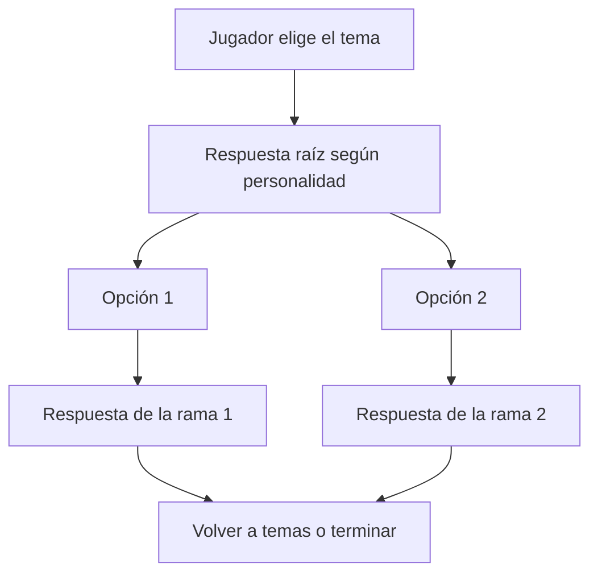

# F3A — Tres árboles de conversación

**Versión:** 0.1 · **Fecha:** 28/10/2026. **Estado:** diseño autorizado, contenido en revisión; no implementado por esta entrega.  
**Fuente canónica:** [biblioteca JSON](F3A_Biblioteca_v0.1.json). [Especificación](F3A_Especificacion_v0.1.md), [contrato de eventos](F3A_Contrato_Eventos_v0.1.md).

## 1. Funcionamiento común

Los tres temas son alternativas de una misma primera conversación, disponibles después de confirmar el primer rescate y con interacción elegible. El jugador elige tema; la compañera responde y ofrece dos opciones. Cada rama termina con una respuesta completa y un cierre, sin crear misión, promesa, puntos de confianza o cambio de orden. Se pueden cerrar los temas en cualquier orden; no se obliga a agotar una entrevista.

Cada árbol tiene una raíz por personalidad y dos hojas por raíz: nueve nodos por tema, 27 en total. Un recorrido elige una hoja; las otras se revisan con una ejecución alternativa, no se concatenan como si ambas elecciones hubieran ocurrido.

Identificadores TSU/YAN/SHY corresponden a Tsundere/Yandere/Shy existentes. El avatar no participa en la selección. El contenido no cambia si el modelo se llama “yandere” o “tímida”.

La raíz se muestra una sola vez en el encuentro. Cancelar después de mostrarla conserva las opciones pendientes; retomar no la pronuncia otra vez. La salida “Terminar conversación” siempre está disponible si no hay prioridad urgente. Una hoja se muestra con su texto completo y acción “Volver a temas” o “Terminar”; no desaparecer antes de poder leerla. El cierre marca solo consumo del tema, no memoria narrativa nueva. Si se agotan los temas, mostrar “No hay temas nuevos por ahora”, sin inventar una frase NPC.

## 2. ¿Qué ocurrió con la trampa?

Árbol: F3A.TREE.TRAP. Entrada por acción del jugador: «¿Qué ocurrió con la trampa?».

### Tsundere

**F3A.TSU.B.TRAP.OPEN** — «Pisé una cuerda y el lazo me levantó antes de que pudiera reaccionar. Menuda manera de recibir a quien pasa por aquí.»

| Elección del jugador | Nodo de respuesta | Respuesta y cierre |
|---|---|---|
| ¿Viste quién la puso? | F3A.TSU.B.TRAP.DETAIL | «No vi a nadie. Eso es lo que más me fastidia: alguien la dejó preparada y se fue. No voy a quedarme debajo a comprobarlo.» → volver a temas o terminar |
| No tienes que explicarlo ahora. | F3A.TSU.B.TRAP.SPACE | «Bien. Hay cosas más urgentes que escucharme protestar. Primero salgamos de junto a la cuerda.» → volver a temas o terminar |

### Yandere

**F3A.YAN.B.TRAP.OPEN** — «El lazo se cerró al pisar. Después solo podía oír el sendero sin ver bien quién pasaba. No quiero volver a sentirme así.»

| Elección del jugador | Nodo de respuesta | Respuesta y cierre |
|---|---|---|
| ¿Viste quién la puso? | F3A.YAN.B.TRAP.DETAIL | «No vi quién la dejó. Me entristece pensar que alguien preparó todo esto para una persona que ni siquiera conocía.» → volver a temas o terminar |
| No tienes que explicarlo ahora. | F3A.YAN.B.TRAP.SPACE | «Gracias por dejarlo ahí. Quiero decidir cuánto cuento, aunque me hayas ayudado.» → volver a temas o terminar |

### Tímida

**F3A.SHY.B.TRAP.OPEN** — «Noté algo en el pie y, de pronto, estaba suspendida. Intenté soltar el nudo, pero no alcanzaba bien.»

| Elección del jugador | Nodo de respuesta | Respuesta y cierre |
|---|---|---|
| ¿Viste quién la puso? | F3A.SHY.B.TRAP.DETAIL | «No vi a nadie. Eso me da pena y miedo: alguien dejó la trampa sin saber quién iba a pasar.» → volver a temas o terminar |
| No tienes que explicarlo ahora. | F3A.SHY.B.TRAP.SPACE | «Sí… Gracias. Prefiero dejar esa parte por ahora. Puedo contarte algo más cuando me tranquilice.» → volver a temas o terminar |

## 3. ¿Cómo te encuentras?

Árbol: F3A.TREE.FEEL. Entrada por acción del jugador: «¿Cómo te encuentras?».

### Tsundere

**F3A.TSU.B.FEEL.OPEN** — «Me tiembla un poco una pierna. No hace falta que me mires así; puedo decirte si necesito parar.»

| Elección del jugador | Nodo de respuesta | Respuesta y cierre |
|---|---|---|
| Puedes tomarte un momento. | F3A.TSU.B.FEEL.BREATH | «Un momento me vendrá bien… Gracias por preguntar en vez de decidir por mí.» → volver a temas o terminar |
| ¿Prefieres que hablemos después? | F3A.TSU.B.FEEL.LATER | «Sí. Prefiero hablar cuando deje de oír esa cuerda en la cabeza. No es culpa tuya.» → volver a temas o terminar |

### Yandere

**F3A.YAN.B.FEEL.OPEN** — «Sigo sobresaltada. Me ayuda poder hablar, pero no quiero que confundas eso con que ya nos conocemos.»

| Elección del jugador | Nodo de respuesta | Respuesta y cierre |
|---|---|---|
| Puedes tomarte un momento. | F3A.YAN.B.FEEL.BREATH | «Gracias. Quédate donde pueda verte mientras respiro; luego seguimos, si te parece.» → volver a temas o terminar |
| ¿Prefieres que hablemos después? | F3A.YAN.B.FEEL.LATER | «Sí. Prefiero escucharte con atención cuando se me pase el sobresalto, no fingir que estoy bien.» → volver a temas o terminar |

### Tímida

**F3A.SHY.B.FEEL.OPEN** — «Todavía me tiembla la voz. Puedo continuar, pero voy a necesitar un momento para ordenar lo que quiero decir.»

| Elección del jugador | Nodo de respuesta | Respuesta y cierre |
|---|---|---|
| Puedes tomarte un momento. | F3A.SHY.B.FEEL.BREATH | «Me gustaría. No necesito que hables todo el tiempo… Con un poco de silencio me basta.» → volver a temas o terminar |
| ¿Prefieres que hablemos después? | F3A.SHY.B.FEEL.LATER | «Sí, después. No es que no quiera hablar contigo; ahora me cuesta encontrar las palabras.» → volver a temas o terminar |

## 4. ¿Qué piensas hacer ahora?

Árbol: F3A.TREE.ROAD. Entrada por acción del jugador: «¿Qué piensas hacer ahora?».

### Tsundere

**F3A.TSU.B.ROAD.OPEN** — «Iba hacia la aldea. Y pienso seguir; esta trampa no va a decidir mi camino.»

| Elección del jugador | Nodo de respuesta | Respuesta y cierre |
|---|---|---|
| Compartamos el camino hasta la aldea. | F3A.TSU.B.ROAD.TOGETHER | «Hasta la aldea, entonces. Nos cuidamos en el sendero; después cada cual decide.» → volver a temas o terminar |
| Aún no sé si me quedaré allí. | F3A.TSU.B.ROAD.UNCERTAIN | «No tienes que decidirlo ahora. Compartir un camino no nos obliga a compartir todos los planes.» → volver a temas o terminar |

### Yandere

**F3A.YAN.B.ROAD.OPEN** — «Quiero llegar a la aldea. Me gustaría saber si tú vas en la misma dirección, antes de seguir a alguien que acabo de conocer.»

| Elección del jugador | Nodo de respuesta | Respuesta y cierre |
|---|---|---|
| Compartamos el camino hasta la aldea. | F3A.YAN.B.ROAD.TOGETHER | «Me parece bien. Quiero que ambos podamos decir si necesitamos parar. Hasta la aldea, paso a paso.» → volver a temas o terminar |
| Aún no sé si me quedaré allí. | F3A.YAN.B.ROAD.UNCERTAIN | «Entonces no decidamos más de lo necesario. Por ahora coincidimos en el sendero; después podemos hablarlo.» → volver a temas o terminar |

### Tímida

**F3A.SHY.B.ROAD.OPEN** — «Iba a la aldea. Me da un poco de apuro pedirlo, pero preferiría no recorrer este tramo sin compañía.»

| Elección del jugador | Nodo de respuesta | Respuesta y cierre |
|---|---|---|
| Compartamos el camino hasta la aldea. | F3A.SHY.B.ROAD.TOGETHER | «Gracias. Y si veo algo que no me convence, te lo diré. No quiero que tengas que decidirlo todo por mí.» → volver a temas o terminar |
| Aún no sé si me quedaré allí. | F3A.SHY.B.ROAD.UNCERTAIN | «Está bien. No hace falta decidir el resto del viaje ahora. Yo sí quiero llegar a la aldea.» → volver a temas o terminar |

## 5. Semántica y límites de las decisiones

- TRAP/DETAIL pide información; no revela un enemigo, ubicación o misión que no existan. Ella no vio quién puso la trampa, aunque el GDD confirma que era de bandidos. TRAP/SPACE respeta su límite y termina sin penalización.
- FEEL/BREATH da espacio/silencio; no ejecuta una orden de espera ni detiene una simulación vital. FEEL/LATER aplaza la charla, sin marcar abandono de promesa.
- ROAD/TOGETHER expresa una alianza temporal hacia la aldea, acorde al prólogo. ROAD/UNCERTAIN no obliga a decidir residencia/hogar ni separa automáticamente a la compañera. Ninguna rama concede una misión o cambia la orden Follow/Wait.
- Si la orden real cambia, ese hecho se presenta por las entradas D correspondientes, no como efecto oculto del diálogo.
- Pausa/peligro suspende presentación y conserva cursor del encuentro; no borra la elección ni repite el primer rescate. Cuando la elegibilidad no está demostrada, no iniciar o reanudar automáticamente.

Las referencias exactas de siguiente nodo y efectos cero viven en el JSON. Los diagramas resumen el flujo, no un motor instalado. La implementación de opciones/cursor sigue pendiente de la infraestructura de Chat 3.
