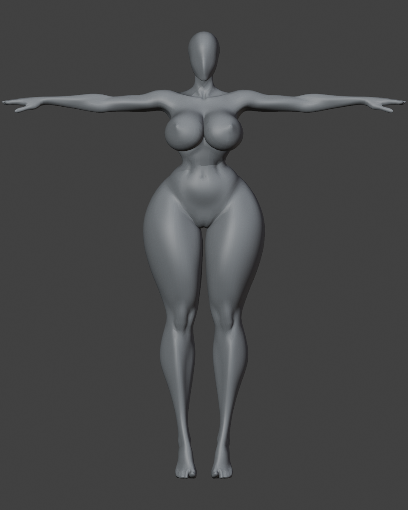
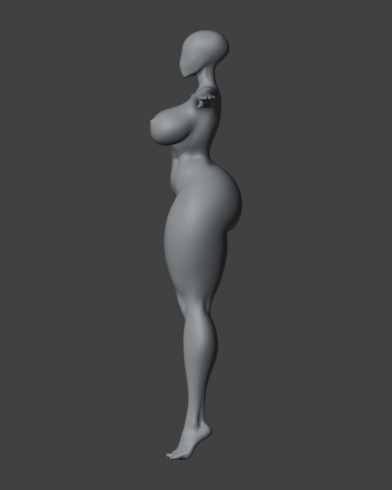
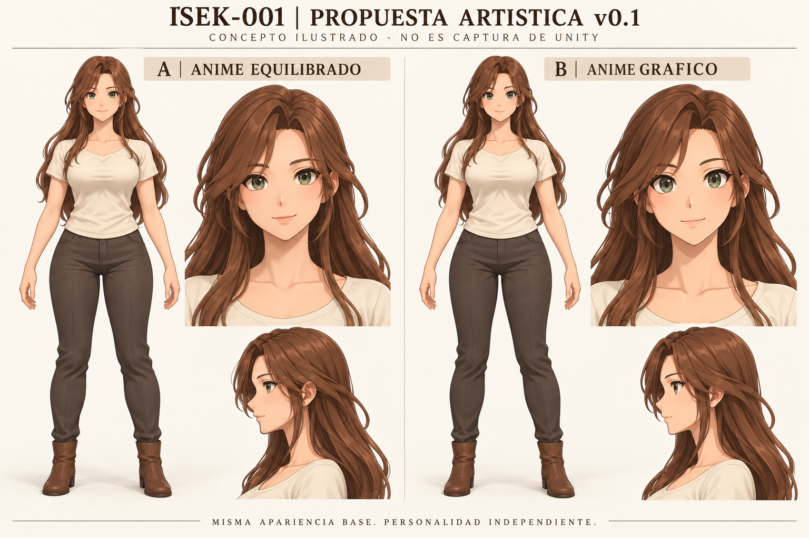
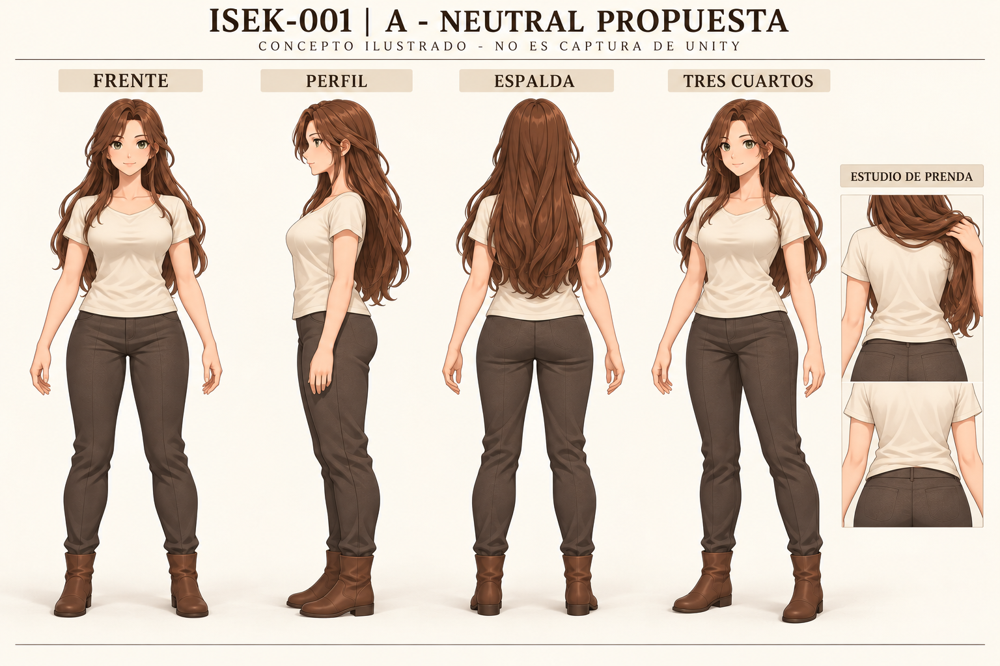
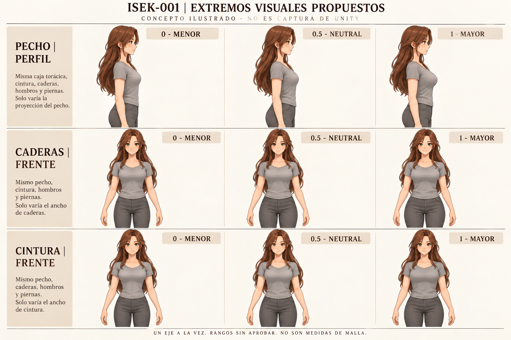
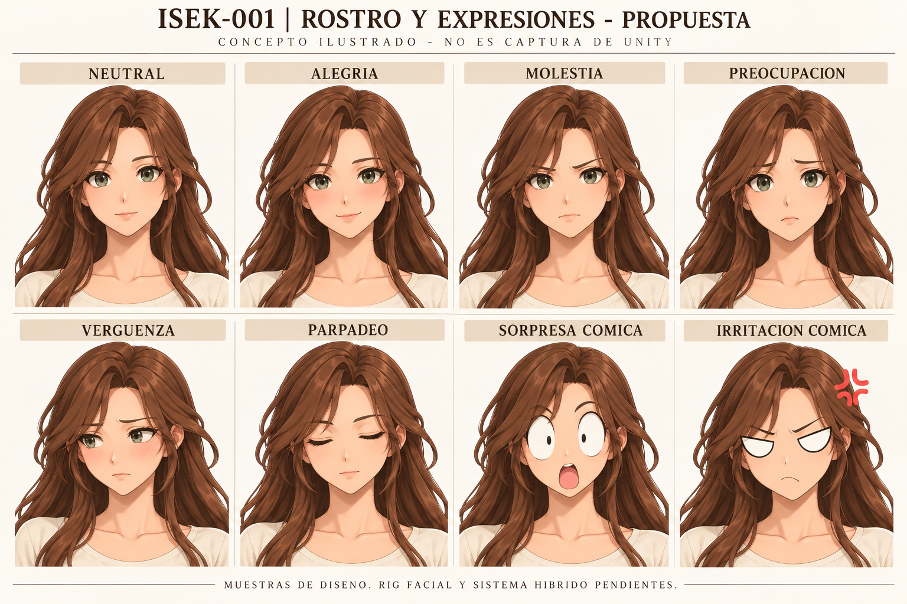

# ISEK-001 — Dirección artística de la compañera

**Versión:** 0.1 · **Fecha:** 28/10/2026, Guatemala.  
**Estado:** PROPUESTA ARTÍSTICA, pendiente de revisión del Chat 1.  
**Responsable:** Chat 2 — Game Design.  
**Autoridad:** [DEC-001 y DEC-002](../DECISIONS.md).  
**Marco:** [ISEK-001 v0.1](ISEK-001.md), [GDD v0.5](../GameDesignDocument_v0.5.md) y [auditoría Woman v1.0](../Audits/ISEK-001/INFORME.md).

## 1. Recomendación para Dirección

Elegir **A — Anime equilibrado** como dirección candidata: mujer adulta, cuerpo promedio estilizado sin cintura pinzada, rostro ovalado con ojos almendrados expresivos, cabello largo suelto, top sencillo y pantalón de tela. Conservar la posibilidad de variar pecho, caderas y cintura de forma independiente. La paleta marrón/marfil/verde sirve para comparar; no define personalidad ni limita los colores del editor.

La neutral propuesta exige remodelar los volúmenes de Woman: reducir la proyección y separación visual del pecho original, suavizar el volumen lateral de caderas/muslos y ensanchar la transición de cintura. El centro del ensayo de auditoría conserva la silueta de origen y **no equivale a esta neutral artística**. El cambio de neutral obligará a revisar también los extremos y sus correctivos.

Esta entrega permite aprobar una intención visual. La aceptación del cuerpo definitivo requiere vistas reales de la nueva malla derivada. No se ha producido ni modificado un modelo 3D en esta revisión.

## 2. Qué está aprobado y qué está pendiente

| Estado | Alcance |
|---|---|
| Aprobado, DEC-001 | Woman de Fly_jkey como base; adultez, equilibrio neutral, apariencia/personalidad independientes y personalización corporal |
| Aceptado, DEC-002 | Evaluación técnica G1 favorable; factibilidad experimental de tres ejes y marco de cuatro puertas/16 criterios |
| Autorizado, DEC-002 | G2-PROTO limitado para Chat 3, en rama del Unity privado; neutral editable, controles experimentales, revisión de transiciones, pesos y ropa |
| Pendiente de aprobación aquí | Alternativa artística, formas neutrales/extremas, rostro, cabello, corte de prendas, muestras expresivas y criterios visuales |
| Pendiente de validación | G3/G4, rostro y ropa finales, locomoción, creador/aventura, rendimiento y licencia detallada |

Esta propuesta no amplía la autorización de G2-PROTO ni permite sustituir el maniquí de las escenas actuales. El GDD v0.6 continúa como borrador. DEC-002 es la referencia vigente para interpretar los estados históricos de ISEK-001 v0.1.

## 3. Evidencia real que condiciona el diseño

Fuente: auditoría publicada en commit `62b613e0b470c7c8f510dcfb87e0c0057ba3a0ca`; DEC-002 consultada en `7416c4b7c190bc6b1c91336eea00adc067ac0113`. Son resultados de ese informe, no pruebas ejecutadas nuevamente por Diseño.

| Evidencia | Consecuencia artística y límite |
|---|---|
| Original: una malla simétrica, 11 022 vértices, cuadriláteros, sin rig ni Shape Keys originales | Reutilizar el cuerpo editable y corregir regiones; no suponer un personaje terminado |
| Pecho/caderas prominentes y cintura muy estrecha en vistas originales | La neutral necesita una nueva distribución de volúmenes, no solo renombrar el valor central |
| Cabeza cerrada sin ojos, boca ni cavidad oral | Rediseño local de cabeza/cuello, ojos y boca; el rostro conceptual no existe en Woman |
| Seis formas diagnósticas, 27 combinaciones; importación Humanoid y Blend Shapes en Unity aislado | Ruta técnica favorable; no acredita rangos artísticos ni editor funcional |
| Penetraciones muestreadas en las 27 combinaciones y 18 poses; hasta unos 4.75 mm en reposo y 7.20 mm en poses | Las superficies de ensayo no son prendas terminadas; necesitan holgura, formas propias y pesos corregidos |
| Estiramiento máximo de arista de 3.578 en poses automáticas | Revisar pelvis/entrepierna, hombros y codos antes de aprobar movimiento |
| Altura normalizada de ensayo de 1.8942 m y textura normal ausente | No fijan altura ni acabado final; materiales de estudio no son cel shading aprobado |

**Referencia real: original de Woman, render de inspección Blender de la auditoría.**

| Frontal original | Perfil original |
|---|---|
|  |  |

Consultar además la [cabeza original](../Audits/ISEK-001/evidence/06-original-head.png), [matriz diagnóstica central](../Audits/ISEK-001/evidence/matrix-waist-1.jpg), [pecho en perfil](../Audits/ISEK-001/evidence/chest-profile-comparison.jpg), [poses diagnósticas](../Audits/ISEK-001/evidence/poses-comparison-1.jpg) y [captura real del importador Unity aislado](../Audits/ISEK-001/evidence/13-unity-isolated-import.png). Esa captura no muestra el personaje integrado en el juego.

## 4. Alternativas comparables

**Las cuatro láminas nuevas son ilustraciones conceptuales.** Usan las vistas reales como referencia del problema y la lámina anterior como continuidad artística. No fueron exportadas de Woman, Blender ni Unity; no prueban conectividad, rig, ropa, medidas o independencia geométrica de controles.

| Aspecto | A — Anime equilibrado, recomendada | B — Anime gráfico |
|---|---|---|
| Rostro | Óvalo adulto, párpados y nariz con volumen suave; ojos almendrados | Apertura ocular más gráfica, planos simplificados y sombras más cortantes |
| Expresión normal | Favorece matices de mirada, boca y cejas | Favorece signos amplios y lectura gráfica |
| Comedia | Contraste visible al pasar del rostro normal al recurso cómico | Continuidad más cercana entre lenguaje normal y exagerado |
| Riesgo a revisar | Que el acabado se vuelva demasiado suave o poco legible a distancia | Que la simplificación reduzca matices o rejuvenezca involuntariamente el rostro |
| Trabajo pendiente | Cabeza nueva, ojos, boca, UV, materiales y pruebas faciales | Las mismas necesidades; no se presupone menor coste ni mejor rendimiento |

Ambas usan el mismo cuerpo adulto, ropa y colores de comparación. No son alternativas de personalidad. Las diferencias entre dibujos son orientativas; la comparación final deberá hacerse sobre una misma cabeza 3D con cámaras y luz iguales.

Se recomienda A por su margen para conversaciones cercanas y para contrastar expresiones normales/cómicas. B queda disponible si Dirección prefiere un lenguaje más gráfico. Conservar sin editar las evidencias y referencias anteriores; esta entrega no las convierte en arte aprobado.

## 5. Neutral corporal y vistas propuestas

**Cuerpo:** adulto de proporciones promedio estilizadas; volumen moderado en pecho y caderas, abdomen natural y transición continua de tórax a pelvis. Postura relajada, pelvis sin giro de presentación, columna sin arqueo forzado y pies apoyados. La adultez se expresa también mediante rostro y proporciones de extremidades; no depende del tamaño del pecho.

**Frente:** comprobar balance de hombros, tórax y pelvis; cintura visible sin efecto de corsé; muslos conectados suavemente a caderas. **Perfil:** pecho integrado al tórax, abdomen continuo y pelvis sin proyección exagerada; cuello y cabeza alineados. **Espalda:** unión de cintura/pelvis, hombros y caída del top legibles también con cabello apartado. **Tres cuartos:** comprobar que el equilibrio sobreviva al giro sin depender de una única cámara.

No fijar altura, proporción de cabezas ni amplitudes en centímetros a partir de los píxeles de estas láminas. La normalización de auditoría no es una altura aprobada. Desarrollo debe presentar las cuatro vistas reales de la neutral de G2-PROTO, con escala uniforme y una versión de inspección sin cabello que oculte las uniones.

## 6. Extremos de los tres controles

Los valores **0 / 0.5 / 1** continúan como convención propuesta del perfil. La auditoría usa índices `0/2, 1/2, 2/2` y formas diagnósticas `-1, 0, +1`; no hay una correspondencia de producto aprobada ni deben copiarse sus desplazamientos al nuevo cuerpo neutral.

| Eje | 0: menor | 0.5: neutral | 1: mayor | Qué debe permanecer estable |
|---|---|---|---|---|
| Pecho | Menor volumen y proyección, continuidad adulta del tórax | Moderado, sin dos volúmenes esféricos separados | Proyección mayor y legible en perfil, sin dominar toda la silueta | Hombros, caja torácica, cintura, pelvis, altura y postura |
| Caderas | Menor anchura lateral, unión continua con muslo | Anchura media y distribución suave | Mayor anchura lateral con transición gradual al muslo | Cintura, pecho, longitud de piernas y posición de rodillas/pies |
| Cintura | Más estrecha, manteniendo transición natural y sin pinzamiento | Abdomen relajado, equilibrio tórax/pelvis | Más ancha, con planos y volumen abdominal conservados | Anchura/proyección de pecho y pelvis, altura y esqueleto global |

El máximo es una opción de personalización del nuevo neutral; no se hereda automáticamente del original de Woman. El control de cintura expresa anchura local, no peso corporal global. Ningún mínimo ni máximo asigna personalidad, clase, atractivo, madurez o capacidad de combate.

**Comparación de amplitudes:** se recomienda iniciar la revisión con un rango moderado como el de la lámina. Mantener el rango diagnóstico original como referencia técnica sirve para detectar fallos, pero no lo recomendamos como apariencia neutral ni como rango artístico aprobado. Si los extremos moderados no resultan distinguibles a tamaño de juego, Dirección debe revisar una ampliación visible; no compensar con posturas o cámara.

La lámina muestra intención, no aislamiento exacto: hay pequeñas variaciones de dibujo, rostro, pliegues y encuadre; las diferencias de caderas son discretas y deben revisarse con siluetas reales. Los rótulos de invariantes son requisitos futuros, no resultados medidos. Para aprobar el rango se necesitan frontal y perfil reales por eje, barridos y las 27 combinaciones sobre la nueva neutral. La lámina de nueve ejemplos no sustituye esa matriz.

## 7. Rostro, ojos y sistema facial híbrido

**Rostro A propuesto:** óvalo adulto, mandíbula suave pero definida, mentón sin punta extrema, nariz simplificada con volumen y boca pequeña con labios y comisuras legibles. Ojos almendrados suficientemente amplios para leer dirección de mirada; iris coloreable, pupila oscura, reflejo controlado y borde de párpado visible. Evitar que la sombra del cabello o un brillo permanente borren pupila/cejas.

La auditoría exige construir estos recursos: rediseño local de cabeza y unión al cuello, flujo de párpados/labios, ojos/iris y solución de boca/interior cuando se abra. No basta dibujar una cara sobre la superficie lisa para acreditar gestos normales en tres cuartos.

| Canal propuesto | Muestra | Lectura buscada |
|---|---|---|
| Normal 3D | Neutral atenta | Mirada presente, cejas relajadas, boca en reposo |
| Normal 3D | Alegría/alivio | Comisuras y mejillas cambian, sin sonrisa fija permanente |
| Normal 3D | Molestia | Tensión breve en cejas/labios; identidad conservada |
| Normal 3D | Preocupación | Cejas internas y mirada comunican inquietud |
| Normal 3D | Vergüenza | Rubor y contacto visual intermitente; no implica romance |
| Normal 3D | Parpadeo | Párpados cierran sin atravesar ojo ni alterar identidad |
| Cómico híbrido | Sorpresa | Ojos gráficos amplios y boca simplificada sustituyen los elementos necesarios |
| Cómico híbrido | Irritación | Ojos gráficos angulares y símbolo temporal junto a sien |

Se propone geometría/formas para el canal normal y atlas/recursos gráficos para exageraciones, conforme al marco híbrido existente. La elección técnica exacta y la deformación de boca quedan para el hito facial autorizado. Ocultar los ojos normales cuando sean sustituidos; impedir duplicados, símbolos flotantes desalineados y residuos al volver a neutral. El peligro interrumpe la comedia según la especificación vigente.

La lámina mantiene una vista casi frontal; no demuestra expresiones en tres cuartos, mirada, habla ni transiciones. Alegría y neutral son próximas: la prueba real deberá ampliar su diferencia mediante boca/mejillas y movimiento, si no se distinguen. El parpadeo ilustrado no acredita una animación.

## 8. Cabello, top y pantalón

**Cabello recomendado:** largo suelto hasta lumbar, raya lateral suave, grandes grupos de mechones y pocos detalles finos; cejas, ojos y comisuras visibles. Comparado con flequillo denso, deja más espacio para lectura facial. Comparado con una única masa rígida, permite una silueta más natural, pero exige comprobar movimiento y contacto con hombros/espalda. No presupone huesos secundarios, física ni un presupuesto de malla ya implementados. Recogerlo no será requisito para leer el rostro.

**Top recomendado:** manga corta, cuello redondo poco profundo, tela opaca, corte sencillo y ligera holgura; faldón por fuera del pantalón, solapando la cintura en reposo y poses exigentes. Evitar adornos que oculten silueta o dificulten tintes. La alternativa ajustada reduce pliegues, pero evidencia más cada penetración; la alternativa muy holgada oculta los controles. Se recomienda holgura intermedia con formas correctivas propias.

**Pantalón recomendado:** tela medieval sencilla, pierna recta con leve ajuste al tobillo, holgura en entrepierna/rodillas y cintura acompañando los tres ejes relevantes. Comparado con pantalón ceñido, facilita movilidad visual sin borrar toda la cadera. No adoptar las superficies recortadas de auditoría como patrón final. Botines planos ilustrados son contexto de vestuario provisional, sin función de clase.

**Ajustes que prevalecen sobre los dibujos:** algunas vistas conservan escote algo angular, costuras de pantalón similares a jeans y pierna más ceñida de lo solicitado. Para una hoja de modelado aprobable, convertir a cuello redondo y costuras de tela sencillas, revisar holgura y presentar esas vistas corregidas. Las láminas no fijan cada costura, pliegue o patrón de prenda.

Piel, cabello, iris, top y pantalón deben compartir lenguaje anime/cel shading. Separar zonas de tinte sin perder pupila, reflejos o sombras. Se recomienda sombra principal por zonas y brillo contenido; su resultado real en URP queda pendiente. No se fija aquí resolución, polígonos, shader o coste de rendimiento sin plataforma y mediciones.

## 9. Independencia de personalidad

La misma cara, cuerpo, cabello y ropa deben admitir tsundere, yandere y tímida. Cambiar personalidad no modifica proporciones, paleta, tamaño ocular ni vestuario. Cambia cuándo y cómo mira, gesticula o reacciona, conforme a los diseños sociales aprobados posteriormente.

Para revisión futura, repetir neutral, alegría, molestia y preocupación con una misma apariencia. Las diferencias corporales de personalidad se ensayan en postura/tiempo de gesto, sin asignar rasgos físicos exclusivos. Una expresión enfadada no identifica por sí sola una personalidad.

## 10. Criterios propuestos de aprobación visual

Todos están pendientes. Complementan los 16 casos existentes; no los reemplazan ni añaden implementación autorizada a G2-PROTO.

| ID | Evidencia real a revisar y condición de aceptación |
|---|---|
| ISEK-001-AV01 | Cuatro vistas del derivado neutral: Dirección reconoce adultez, equilibrio y corrección de la cintura pinzada del original |
| ISEK-001-AV02 | Comparación original/neutral misma cámara, escala y pose: cambios intencionales claros; sin usar perspectiva para disimular volúmenes |
| ISEK-001-AV03 | Tres valores por eje en frontal/perfil con los demás neutrales: extremos distinguibles y regiones ajenas estables; inspección visual y datos de aislamiento |
| ISEK-001-AV04 | 27 combinaciones reales sobre nueva neutral y barridos: sin saltos, pliegues anatómicos accidentales ni siluetas rechazadas; defectos registrados |
| ISEK-001-AV05 | Rostro real frontal/perfil/tres cuartos: identidad adulta coherente, párpados, pupila y boca legibles, sin depender del dibujo frontal |
| ISEK-001-AV06 | Expresiones y transiciones reales a distancia de conversación y de juego: neutral, alegría, molestia y preocupación distinguibles; comedia revierte limpiamente |
| ISEK-001-AV07 | Cabello en giro y mirada: ojos/cejas siguen legibles; hombros, cuello y espalda sin penetraciones persistentes |
| ISEK-001-AV08 | Prendas con combinaciones/poses exigentes: cobertura, holgura y uniones continuas; no ocultar fallos con cabello, cámara o iluminación |
| ISEK-001-AV09 | Misma apariencia al cambiar entre tres personalidades; gesto y expresión pueden variar sin cambiar anatomía ni colores |
| ISEK-001-AV10 | Tras autorización de integración, creador y aventura conservan identidad/materiales; capturas reales de Unity identifican versión, cámara y controles |

AV01–04 orientan la revisión corporal de G2-PROTO. AV05–10 preparan revisiones posteriores; no desbloquean G3/G4. Aceptar un concepto no da por superado ninguno de estos casos.

Para las comparaciones usar vistas ortográficas frontal/perfil/espalda y tres cuartos consistente, misma pose relajada, material mate de inspección y luz fija. Añadir versiones con ropa y de silueta sin oclusiones. Registrar valores, versión de archivo, defectos, cámara y resultado. Después comprobar luz y encuadre reales del juego; el material de inspección no sustituye esa prueba.

## 11. Decisiones solicitadas al Chat 1

| Punto | Resolución solicitada | Límite de aprobación |
|---|---|---|
| ISEK-001-ART01 | Elegir A, B o ajustes concretos de rostro/sombreado | Dirección candidata; cabeza 3D final pendiente |
| ISEK-001-ART02 | Aprobar intención neutral moderada y correcciones respecto de Woman | No acepta aún un cuerpo real ni fija altura |
| ISEK-001-ART03 | Aprobar intención de extremos moderados para pecho/caderas/cintura | Amplitudes geométricas pendientes de vistas reales y matriz |
| ISEK-001-ART04 | Aprobar cabello lumbar, top redondo con holgura y pantalón de tela descritos | Prendas, cabello y correcciones de las láminas pendientes de modelado |
| ISEK-001-ART05 | Aprobar lenguaje facial híbrido y criterios AV01–10 | No autoriza por sí solo rig facial, ropa final ni integración |

Registrar resoluciones por punto y versión. Una aceptación de la dirección permitirá contrastar el próximo derivado de G2-PROTO; Chat 1 decide después el alcance siguiente. Esta entrega no declara el arte definitivo, ISEK-001 completa ni nuevas decisiones aprobadas.

## 12. Entrega, procedencia y comprobaciones

Cuatro PNG y sus [briefs visuales completos](../references/ISEK-001-art-v0.1/briefs-visuales.json) residen en `Documentation/references/ISEK-001-art-v0.1/`. Se utilizó la herramienta integrada de imágenes; no el flujo CLI/API. Las imágenes son referencias ilustradas de diseño, sin modificación del FBX ni edición de evidencias de auditoría. Se revisaron visualmente etiquetas, contenido y límites descritos arriba.

Base acreditada: **Woman — Fly_jkey**, [modelo original](https://sketchfab.com/3d-models/woman-b303b7606140480f8335cda121b9607c), fuente `assets/woman.fbx`, SHA-256 `674c07ff612577a1a5b7e7ee124202722fa5eb0f68bdc01c820a875b5bef1d87`. DEC-001 registra CC BY; la variante exacta y el enlace de licencia siguen pendientes según DEC-002. Estas láminas plantean cambios de proporciones, rostro, cabello y vestimenta; no se distribuye una nueva malla derivada con ellas.

La revisión documental comprueba enlaces, estado de propuesta y trazabilidad con DEC-002/auditoría. No se ejecutaron Blender, Unity, deformaciones, clips ni builds en esta entrega. Los resultados técnicos citados pertenecen exclusivamente a la auditoría enlazada. El código, escenas, recursos Unity, puntero del submódulo, decisiones aprobadas y FBX original quedan fuera de los cambios de esta propuesta.

**Registro 0.1 — 28/10/2026:** comparación de dos alternativas, recomendación A, turnaround conceptual, rangos ilustrados, batería facial, vestuario/cabello, diez criterios visuales y cinco puntos de decisión; entrega para revisión artística solicitada en DEC-002.
