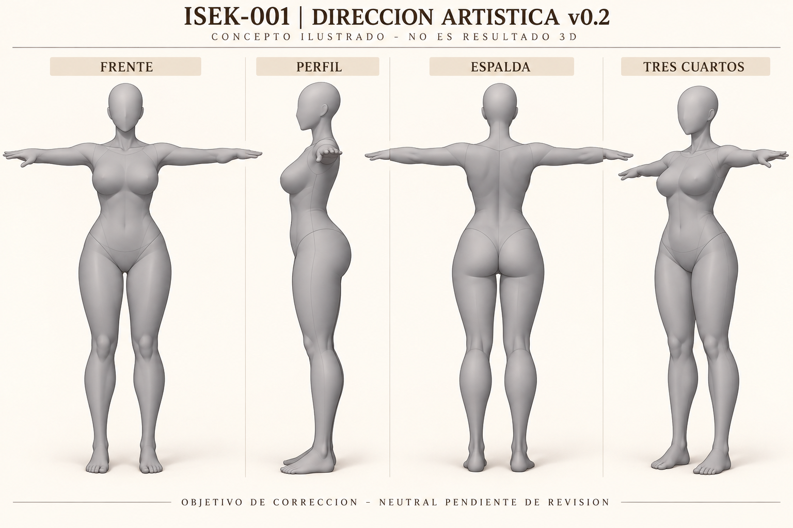
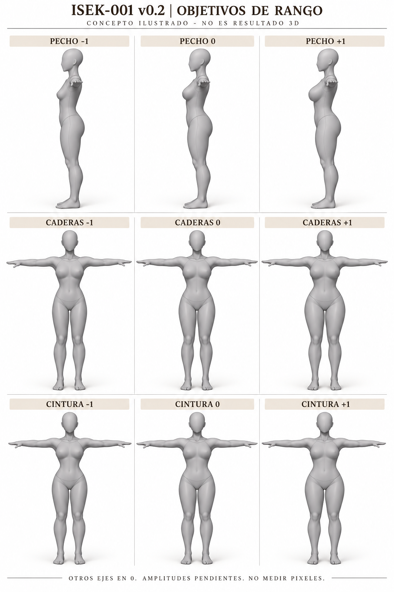
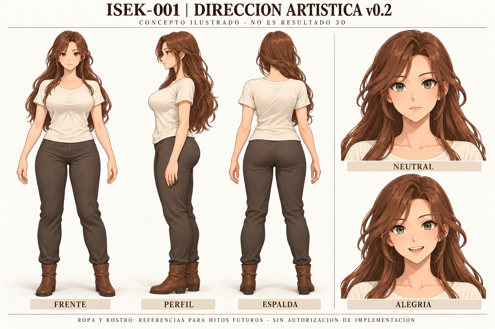

# ISEK-001 — Dirección artística v0.2 / correcciones de G2-PROTO

**Fecha:** 28/10/2026, Guatemala.  
**Estado:** PROPUESTA DE CORRECCIÓN; arte final pendiente del usuario y Chat 1.  
**Responsable:** Chat 2 — Game Design.  
**Autoridad vigente:** [DEC-003](../DECISIONS.md#dec-003--revisión-de-g2-proto-y-continuidad-limitada-de-correcciones), [Issue #1](https://github.com/MarcoPolo2-0/Isekaid/issues/1).  
**Referencias:** [ISEK-001](ISEK-001.md), [dirección v0.1](ISEK-001_Direccion_Artistica_v0.1.md) y [GDD v0.5](../GameDesignDocument_v0.5.md).

## 1. Resolución que guía esta revisión

DEC-003 selecciona A — Anime equilibrado como referencia de trabajo, aprueba la intención neutral moderada y permite únicamente G2-CORR. La neutral de G2-PROTO **requiere correcciones**. Los extremos, la neutral real, el rostro y el arte final no están aceptados. G3/G4 completas, prendas/cabello/rostro finales e integración siguen sin autorización.

Esta versión desarrolla las correcciones de pecho/tórax, cintura y pelvis/muslo ya solicitadas. Las precisiones visuales, ejemplos de revisión y requisitos adicionales de esta v0.2 son **PROPUESTAS para Dirección**; no amplían automáticamente el alcance de Chat 3. AV05–10 mantienen su estado propuesto para hitos posteriores. Apariencia y personalidad permanecen independientes.

## 2. Fuentes, acceso y tipos de imagen

- DEC-003 revisada en commit `759c5d24fc73989230ab9b77ee9ba4322805e4ba`.
- Issue #1 leído con cuerpo vigente actualizado a `2026-10-28T16:36:20Z`, estado abierto, y comentario de entrega G2-PROTO de Desarrollo.
- G2-PROTO: [informe](https://github.com/MarcoPolo2-0/Isekaid-2026-10-27_13-09-18/blob/afcdd61649bac3cabc833605d61037006eaf6509/SourceArt/Companion/Woman/G2-PROTO/INFORME.md), commit `afcdd61649bac3cabc833605d61037006eaf6509`, rama `feature/isek-001-g2-body`, [PR privado #2](https://github.com/MarcoPolo2-0/Isekaid-2026-10-27_13-09-18/pull/2), en borrador.
- A: lado izquierdo de la [comparación v0.1](../references/ISEK-001-art-v0.1/01-alternativas.png), commit `4610d8a6997d8dc1f66650b4a69a3379ecedcace`.
- [Registro de 16 fuentes contrastadas](../references/ISEK-001-art-v0.2/fuentes-verificadas.json): hashes SHA-256 y coincidencia de blobs locales con el commit privado indicado. Esto no reejecuta Blender/Unity ni valida todo el paquete.

| Tipo | Uso en esta revisión |
|---|---|
| Resultado 3D real | Renders originales de G2-PROTO enlazados al commit fijo; conservan archivos, encuadre y sombreado originales |
| Anotación sobre evidencia | Tabla R01–R03 y observaciones de extremos: identifican archivo, vista, zona y defecto; son anotaciones textuales, no geometría corregida |
| Concepto | Tres láminas nuevas de objetivo, rotuladas como ilustración; no se obtuvieron renderizando una malla corregida |

Los renders originales siguen en el repositorio privado y requieren acceso. No se copian sus recursos al repositorio público. Las referencias conceptuales nuevas y la documentación están en el principal. No se retocaron ni sustituyeron evidencias originales; ninguna lámina nueva se presenta como captura Unity o resultado de G2-CORR.

## 3. Lectura de G2-PROTO frente a A

Vistas reales sin cabello ni prendas que oculten el cuerpo:

| Vista real | Lectura para corrección |
|---|---|
| [Frontal neutral](https://github.com/MarcoPolo2-0/Isekaid-2026-10-27_13-09-18/blob/afcdd61649bac3cabc833605d61037006eaf6509/SourceArt/Companion/Woman/G2-PROTO/evidence/neutral-body-front.png) | Dos masas de pecho casi esféricas y separación central marcada; cintura corta/pinzada bajo tórax; anchura cambia bruscamente en pelvis alta |
| [Perfil neutral](https://github.com/MarcoPolo2-0/Isekaid-2026-10-27_13-09-18/blob/afcdd61649bac3cabc833605d61037006eaf6509/SourceArt/Companion/Woman/G2-PROTO/evidence/neutral-body-side.png) | Pecho proyectado con unión abrupta superior/inferior; concavidad lumbar y proyección posterior dominan la transición pelvis/muslo |
| [Espalda neutral](https://github.com/MarcoPolo2-0/Isekaid-2026-10-27_13-09-18/blob/afcdd61649bac3cabc833605d61037006eaf6509/SourceArt/Companion/Woman/G2-PROTO/evidence/neutral-body-back.png) | Revisar transición cintura–cresta pélvica y pliegue glúteo/muslo; no basta estrechar la silueta frontal |
| [Tres cuartos neutral](https://github.com/MarcoPolo2-0/Isekaid-2026-10-27_13-09-18/blob/afcdd61649bac3cabc833605d61037006eaf6509/SourceArt/Companion/Woman/G2-PROTO/evidence/neutral-body-threequarter.png) | La separación pecho/tórax y los cambios de plano en cintura/pelvis siguen visibles al girar |
| [Original frente a neutral, cuatro vistas](https://github.com/MarcoPolo2-0/Isekaid-2026-10-27_13-09-18/blob/afcdd61649bac3cabc833605d61037006eaf6509/SourceArt/Companion/Woman/G2-PROTO/evidence/original-vs-neutral.jpg) | Existe modificación localizada, pero no alcanza todavía el equilibrio solicitado; no confundir “modificado” con “aceptado” |

A proporciona una identidad anime adulta y un balance general vestido. No permite deducir la anatomía bajo la tela ni medir amplitudes por píxeles. La v0.2 complementa esa referencia con un objetivo corporal sin cabello y con superficie gris de inspección ilustrada.

### Anotaciones localizadas y correcciones

| ID / región | Localización en evidencia real | Corrección solicitada dentro del objetivo DEC-003 | Comprobación visual de salida |
|---|---|---|---|
| R01 — Pecho/tórax | Frontal: separación esternal y bordes inferiores de ambos volúmenes. Perfil: raíz superior y base inferior del pecho. Tres cuartos: inserción lateral junto a axila | Reducir forma de esfera aislada; distribuir la unión sobre el tórax, suavizar raíz superior/lateral y transición inferior. Moderar proyección desde la nueva neutral; conservar lectura del esternón sin surco artificial. No resolver juntando dos esferas ni estrechando todo el tórax | Frente y tres cuartos muestran volumen integrado; perfil sin escalón/pico en raíz. Hombros, costillas y postura estables al cambiar solo pecho |
| R02 — Cintura | Frente y tres cuartos: franja inmediatamente bajo costillas hasta pelvis alta. Espalda/perfil: cambio lumbar hacia cresta pélvica | Rellenar el estrechamiento brusco y repartir la transición a lo largo de la zona media. Abdomen relajado y flancos continuos, sin corsé ni anillo que separe tórax/pelvis. No corregir inclinando pelvis o arqueando columna | Curva continua en cuatro vistas, sin quiebre brusco. El mínimo conserva esa continuidad y el máximo no aplana todo el tronco |
| R03 — Pelvis/muslo | Frente: borde lateral superior de pelvis y entrada a muslo. Perfil/espalda: proyección glútea y pliegue hacia muslo. Tres cuartos: conexión inguinal | Suavizar la cresta lateral y repartir anchura hacia muslo proximal; moderar proyección posterior de la neutral y revisar el pliegue glúteo. Conservar articulación de cadera y separación anatómica de piernas; evitar bulto añadido, hueco inguinal o escalón | Frente, perfil y espalda muestran transición continua; no se ensanchan rodillas/pies ni se alargan piernas. La corrección frontal no empeora perfil o espalda |

Las sombras sugieren discontinuidades, pero una imagen no distingue por sí sola forma, normales y efecto de iluminación. Antes de esculpir un defecto aparente, contrastar superficie y normales con material mate y vistas consistentes. Estos puntos no prescriben un algoritmo ni autorizan reconstruir el cuerpo o cambiar el rig global.

## 4. Objetivo neutral propuesto

**Neutral:** pecho moderado unido al tórax, cintura natural y transición continua a pelvis/muslo, abdomen relajado; mujer adulta de constitución promedio estilizada. Cabeza, manos, pies, altura y postura no son herramientas para disimular las correcciones. La cabeza lisa de inspección no define el rostro final.

La lámina muestra cuatro vistas conceptuales en T para acercarse al ensayo real. El recubrimiento gris y sus líneas son recurso de dibujo; no representan ropa autorizada, topología, costuras finales ni una nueva malla. Sus leves variaciones de manos, cabeza y silueta entre vistas no son especificaciones de modelado.

Neutral es el **nuevo punto base** que debe corregirse primero; no es la media aritmética obligatoria de dos extremos antiguos ni el estado original de Woman. No conservar la cintura pinzada como mínimo automático. Mantener la versión G2-PROTO recuperable y presentar antes/después con idénticas cámaras, pose, luz y escala. No fijar altura o centímetros a partir de estas imágenes.

## 5. Extremos propuestos sobre la neutral corregida

Aquí se utiliza la notación experimental **P/C/W = -1, 0, +1**, igual a las matrices de G2-PROTO: P pecho, C caderas, W cintura. **0 es neutral**. No convierte los valores en contrato del perfil, no cambia UI ni aprueba la propuesta anterior de perfil 0–1/neutral 0.5. En el ensayo Minus/Plus pertenecen a un eje y no se activan ambos extremos simultáneamente.

| Eje / vistas para decidir | -1 propuesto | 0 propuesto | +1 propuesto | Invariantes a demostrar |
|---|---|---|---|---|
| Pecho: perfil y tres cuartos, con frontal auxiliar | Menor proyección y volumen; unión amplia al tórax, no superficie colapsada | Moderado y continuo, R01 resuelta | Mayor volumen legible, sin esferas separadas ni raíz escalonada | Caja torácica, hombros, cintura, pelvis, altura y pose |
| Caderas: frente/espalda, perfil auxiliar | Menor anchura lateral, sin hendidura inguinal | Pelvis media y continuidad al muslo, R03 resuelta | Mayor anchura repartida en pelvis/muslo proximal, sin “repisa” lateral | Pecho, cintura, articulaciones de cadera, longitud de piernas, rodillas y pies |
| Cintura: frente/tres cuartos y perfil auxiliar | Más estrecha, transición larga; no vuelve al pinzamiento de G2-PROTO | Abdomen/flancos naturales, R02 resuelta | Más ancha, conservando volumen y continuidad del abdomen | Pecho, anchura pélvica, esqueleto global, altura y postura |

**Lectura de extremos reales revisados:**

- [Cintura -1](https://github.com/MarcoPolo2-0/Isekaid-2026-10-27_13-09-18/blob/afcdd61649bac3cabc833605d61037006eaf6509/SourceArt/Companion/Woman/G2-PROTO/evidence/combinations/1_1_0_front.png) y [cintura +1](https://github.com/MarcoPolo2-0/Isekaid-2026-10-27_13-09-18/blob/afcdd61649bac3cabc833605d61037006eaf6509/SourceArt/Companion/Woman/G2-PROTO/evidence/combinations/1_1_2_front.png), otros ejes en 0: el mínimo mantiene una constricción fuerte; el máximo altera anchura, pero ambos deben recalcularse desde R02. No aprobar ninguno por ser finito.
- [Caderas -1](https://github.com/MarcoPolo2-0/Isekaid-2026-10-27_13-09-18/blob/afcdd61649bac3cabc833605d61037006eaf6509/SourceArt/Companion/Woman/G2-PROTO/evidence/combinations/1_0_1_front.png) y [caderas +1](https://github.com/MarcoPolo2-0/Isekaid-2026-10-27_13-09-18/blob/afcdd61649bac3cabc833605d61037006eaf6509/SourceArt/Companion/Woman/G2-PROTO/evidence/combinations/1_2_1_front.png): el cambio lateral se aprecia, pero todavía hay una unión alta marcada. Suavizar la transición con muslo en ambos extremos, no solo reducir amplitud.
- [Matriz lateral real](https://github.com/MarcoPolo2-0/Isekaid-2026-10-27_13-09-18/blob/afcdd61649bac3cabc833605d61037006eaf6509/SourceArt/Companion/Woman/G2-PROTO/evidence/matrix-27-side.jpg) y [frontal real](https://github.com/MarcoPolo2-0/Isekaid-2026-10-27_13-09-18/blob/afcdd61649bac3cabc833605d61037006eaf6509/SourceArt/Companion/Woman/G2-PROTO/evidence/matrix-27-front.jpg): permiten localizar variaciones P/C/W, pero el tamaño de la lámina no basta para aceptar inserciones, aislamiento o cruces. El pecho debe revisarse en las muestras de perfil completas y con otros ejes en 0.

Los nueve dibujos son anclas de intención; las 27 combinaciones son evidencia futura de la malla corregida. Las láminas tienen variaciones ilustrativas de planos y encuadre: no medir sus píxeles ni asumir invariantes cumplidos. La neutral del turnaround es la referencia principal de continuidad; una curva demasiado pinzada en un dibujo de rango no prevalece sobre R02.

Los extremos deben distinguirse en vistas reales comparables. Si la variación es demasiado discreta, proponer ajuste visible a Dirección. No reducir rangos silenciosamente para esconder deformaciones. No convertir cintura en peso global ni ligar atributos físicos a personalidad, clase, madurez o capacidad.

## 6. AV01–04: revisión por punto

| Criterio conservado | Estado sobre afcdd61 | Qué se reconoce de la evidencia | Corrección/evidencia necesaria para nueva revisión |
|---|---|---|---|
| AV01 / AC03 | REQUIERE CORRECCIONES | Cuatro vistas reales sin cabello entregadas; neutral modificada | Resolver R01–03 y entregar de nuevo cuatro vistas; Dirección juzga equilibrio adulto y continuidad. La lámina conceptual no supera AV01 |
| AV02 / AC03 | COMPARACIÓN ENTREGADA; OBJETIVO VISUAL NO ACEPTADO | Existe original/neutral en cuatro vistas; modificación visible | Comparar G2-PROTO/G2-CORR y conservar original como trazabilidad, mismas cámaras/pose/escala/luz. No usar A vestida como medición anatómica |
| AV03 / AC04–06 | PARCIAL | Tres ejes y seis formas; archivos de muestra y protección parcial de regiones | Recalcular extremos desde nueva neutral; barridos individuales, vistas frontal/perfil y verificación de invariantes por región. Cabeza/manos/pies estables no prueban tórax/cintura/pelvis independientes |
| AV04 / AC07 | PARCIAL | 27 estados estáticos y 108 renders publicados; datos finitos, sin colapso bajo umbral del ensayo | Nuevas 27 combinaciones, cuatro vistas, barridos continuos y revisión de autointersecciones/cruces. Registrar defectos de combinaciones mixtas; no aceptar por ausencia de NaN |

Estas son observaciones de Diseño para la revisión de Chat 1; no nuevas aceptaciones de G2. AV05–10 no se revisan como implementados ni se marcan aprobados.

**Propuesta de presentación para hacer verificable AV03/04:** registrar en el informe cada eje, dirección de barrido, controles restantes, regiones estables, defecto y archivo de evidencia. Mostrar barridos de ida/vuelta con otros ejes neutrales y combinaciones mixtas exigentes identificadas, conforme a DEC-003. No se imponen aquí una duración, frecuencia de muestreo o tolerancia numérica nuevas como aprobadas. Acompañar las imágenes con comprobaciones de desplazamiento por región y explicar las zonas de transición compartidas; no exigir que todo vértice vecino tenga delta cero si un correctivo local evita discontinuidades.

**Orden de revisión:** neutral y rangos primero. En el diagnóstico de ropa/pesos ya autorizado, repetir al menos los mismos 18 casos comparables y reportar la regresión de clipping; no convertir esta revisión visual en una exigencia de ejecutar G3 completa.

## 7. Corrección conceptual del vestuario y neutral/alegría

| Inconsistencia v0.1 | Referencia corregida v0.2 | Condición de revisión futura |
|---|---|---|
| Escote algo angular/cambiante entre vistas | Cuello redondo poco profundo y continuo en frente/perfil/espalda, sin V, muesca ni cordones | Presentar un mismo patrón alrededor del cuello; comprobarlo al girar |
| Apariencia de jeans y costuras/piezas inconsistentes | Pantalón de tela mate sencilla, sin remaches, bolsillos traseros de parche, canesú de jeans o cremallera ilustrada; costuras laterales e interior de pierna coherentes | La línea central frontal se interpreta como costura/pliegue de tela, no diseño de bragueta. No añadir detalles modernos al modelar |
| Ajuste excesivo y cobertura incierta de cintura | Top con holgura visible bajo axila/pecho y faldón por fuera, solapando cintura; pantalón recto con espacio en entrepierna/rodillas | Mostrar mismo corte y continuidad del solape en cuatro vistas y poses cuando se autoricen prendas finales |
| Neutral y alegría próximas | Neutral: labios cerrados relajados, comisuras sin sonrisa fija, mejillas en reposo. Alegría: sonrisa abierta visible, comisuras elevadas, mejillas activas y ligera reducción del párpado inferior | Distinguirlas sin rubor, cambio de color, etiqueta o inclinación de cabeza. Mantener misma identidad |

Las ilustraciones nuevas corrigen la dirección de cuello, costuras y holgura; no son patrones técnicos. Pliegues del pantalón, proyección de busto bajo tela y pequeñas diferencias de pose siguen siendo orientativos. La lámina corporal sin cabello gobierna las correcciones de neutral, no el volumen aparente de la tela. Las líneas de inspección de los maniquíes no se trasladan al vestuario.

El cabello se mantiene largo y suelto como referencia futura; se aparta en el estudio trasero de prendas para dejar visible el cuello y el solape. Las pruebas corporales G2-CORR deben permanecer sin cabello que oculte regiones críticas.

Alegría no exige romance ni define una personalidad. La misma anatomía, cara, colores y prendas admiten cualquier personalidad. Cambiar personalidad no cambia proporciones, ojos o cuerpo. El sistema facial híbrido conserva la dirección previa; estas dos caras son propuestas de lectura, no Shape Keys, rig facial o animaciones implementadas.

## 8. Límites técnicos que permanecen abiertos

El informe de Desarrollo registra 0/27 combinaciones en reposo con penetración de vértices superior al umbral de ensayo y separación mínima de aproximadamente 1.68 mm. No certifica ausencia de cruces entre triángulos. Las muestras de ropa siguen abiertas y no son top/pantalón finales.

En poses permanecen 9/18 casos con penetraciones; la peor profundidad pasa de 7.20 a 13.70 mm y el estiramiento máximo sigue en 3.578. Son resultados publicados, no pruebas repetidas aquí. Las 18 poses no satisfacen las 162 configuraciones previstas para G3. No inflar globalmente las muestras para resolver un fallo local.

La importación Unity aislada demuestra Avatar Humanoid/Blend Shapes y combinaciones corporales, no ropa/cuerpo sincronizados en toda la matriz, retargeting, Play Mode, URP final o escenas del juego. DEC-003 exige revisar sincronización y contactos en G2-CORR; este documento no declara resuelto ninguno.

## 9. Decisiones para Chat 1 y entrega

1. Confirmar o ajustar R01–03 y la lectura visual de neutral/extremos antes de aceptar un nuevo cuerpo.
2. Revisar AV01–04 con los próximos resultados reales, conservando los estados parciales actuales.
3. Revisar las precisiones conceptuales de cuello, costuras, holgura y neutral/alegría para hitos futuros. No autorizan construir rostro, cabello o prendas finales.
4. Resolver cualquier precisión adicional como PROPUESTA; mantener G2-CORR y PR #2 sin fusionar hasta nueva revisión.

Las fuentes G2-PROTO, evidencias de auditoría y láminas v0.1 se conservan. Esta v0.2 es un nuevo documento versionado, no una sustitución de decisiones aprobadas. No se actualiza el submódulo ni se modifica Unity, la malla o el original Woman.

**Procedencia:** Woman, Fly_jkey, [modelo original](https://sketchfab.com/3d-models/woman-b303b7606140480f8335cda121b9607c). La variante exacta CC BY/atribución sigue pendiente según DEC-003. No se distribuye una malla derivada nueva en esta entrega.

**Archivos de la propuesta:** tres PNG en `Documentation/references/ISEK-001-art-v0.2/`, [briefs completos](../references/ISEK-001-art-v0.2/briefs-visuales.json) y registro de fuentes. Se utilizó la herramienta integrada de imágenes, sin flujo CLI/API. La revisión visual de conceptos y la comprobación documental no equivalen a producir un derivado 3D.

**Validación de esta entrega:** lectura de DEC-003/Issue, contraste de 16 fuentes, inspección de las cuatro vistas neutrales, comparación original/neutral, matrices frontal/lateral y muestras seleccionadas de extremos. No se inspeccionaron individualmente todas las poses ni se ejecutaron Blender, Unity, clips o builds. La prueba de enlaces locales y conservación de originales acompaña la publicación; no marca AV01–04 como superados.

**Registro 0.2 — 28/10/2026:** dirección A aplicada a observaciones reales G2-PROTO, R01–03, objetivos neutrales/extremos, revisión AV01–04 y correcciones conceptuales. Publicación para revisión y enlace al Issue #1. G2 e ISEK-001 permanecen abiertas.
