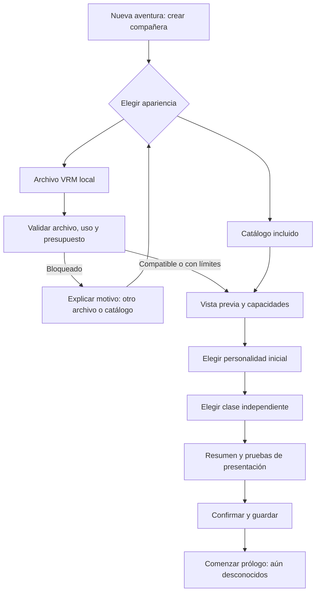

# ISEKAID — Apariencia por avatares VRM y catálogo local

**Versión:** 0.2 · **Fecha:** 28/10/2026, Guatemala.  
**Diseño conceptual:** APROBADO CON AJUSTES por Chat 1; VRM + catálogo es la dirección preferida, condicionada a evaluación técnica.  
**Implementación definitiva:** PENDIENTE de los resultados de Chat 3.  
**Revisión documental v0.2:** incorpora los seis ajustes solicitados; los detalles no ratificados y criterios nuevos permanecen como propuestas. No modifica el GDD v0.5 ni cierra ISEK-001.  
**Responsable:** Chat 2 — Game Design. **ID de nueva tarea:** pendiente de Dirección.  
**Relacionada con:** [ISEK-001](ISEK-001.md), [dirección artística v0.2](ISEK-001_Direccion_Artistica_v0.2.md), [GDD v0.5](../GameDesignDocument_v0.5.md).  
**Decisiones consultadas:** [DEC-005 y DEC-006, versión remota vigente](https://github.com/MarcoPolo2-0/Isekaid/blob/83553e9/Documentation/DECISIONS.md). La aprobación conceptual y los ajustes proceden de la instrucción directa de Chat 1 del 28/10/2026. No se inventa un número DEC ni se edita el registro de decisiones. Historial: [propuesta v0.1](Sistema_Companera_VRM_v0.1_PROPUESTA.md).

## 1. Propuesta y límites de autoridad

La dirección conceptual aprobada es reemplazar, sujeto a validación técnica y aprobación definitiva del cambio de alcance, el objetivo de un editor corporal propio por dos vías equivalentes de apariencia: importar un archivo VRM local o seleccionar un avatar incluido con el juego. Personalidad y clase se eligen aparte. El creador prepara una identidad visual para una desconocida que el jugador conocerá en la aventura; no concede amistad ni romance.

La profundidad emocional, memoria, hábitos, preferencias, iniciativas, desacuerdos, autonomía, progresión y misiones personales se mantienen. Un modelo con menos expresiones tiene menor capacidad visual, no menor inteligencia ni menos contenido de relación.

**DEC-005 sigue vigente:** G2-CORR fue rechazada visualmente; G2-PROTO conserva valor como referencia estilizada y “neutral” significa base de controles, no silueta simplificada. Importar VRM no demuestra que Woman sea inviable ni justifica aplanar la dirección artística. Woman, G2-PROTO, G2-CORR y sus evidencias se conservan. La instrucción posterior de Chat 1 conserva Woman, G2-PROTO y G2-CORR como trabajo histórico y pausa de momento nuevas correcciones corporales. Esa pausa no acepta sus defectos ni los declara obsoletos. ISEK-001 permanece abierta; no se reanuda trabajo corporal sin nueva instrucción.

**DEC-006:** repositorio único MarcoPolo2-0/Isekaid; proyecto en UnityProjectIsekaid/. Referencias históricas al repositorio privado/submódulo no definen el flujo nuevo. Esta entrega se limita a documentación.

## 2. Qué aporta VRM y qué no garantiza

VRM ofrece un formato de avatar humanoide con recursos de apariencia y metadatos; existe una ruta de carga en ejecución documentada por UniVRM. Eso no prueba su compatibilidad con nuestra versión de Unity, materiales, animaciones o plataformas: requiere un experimento aprobado y acotado. [Documentación oficial de desarrollo VRM](https://vrm.dev/en/vrm/vrm_development/).

VRM 0.x y 1.0 presentan diferencias de estructura, orientación y expresiones. **VRM 1.0 es el formato inicial aceptado por Chat 1**. VRM 0.x queda pendiente, fuera de la primera implementación; solo se anunciará tras una autorización y pruebas específicas de su ruta. No basta cambiar la extensión ni convertir nombres. [Cambios oficiales de VRM 1.0](https://vrm.dev/en/vrm1/changed/).

El archivo aporta presentación, no recuerdos, personalidad, diálogos, clase, ataques, consentimiento romántico o historia. Tampoco garantiza rostro cómico, ropa intercambiable, manos aptas para agarrar armas, cámara de conversación adecuada o rendimiento aceptable.

## 3. Alcance funcional propuesto

| Incluido en el sistema propuesto | Fuera de este alcance |
|---|---|
| Importación local, validación, previsualización y copia privada gestionada por el juego | Descarga de avatares desde servicios, cuentas externas, tienda o publicación de modelos |
| Catálogo integrado usable desde la primera ejecución sin Internet | Editor de cuerpo, cara, cabello, texturas o prendas dentro del juego |
| Selección independiente de apariencia, personalidad inicial y clase | Convertir cualquier formato 3D o reparar topología automáticamente |
| Adaptación de expresiones y gestos a capacidades conocidas | Prometer que todo archivo .vrm es compatible o iguala la expresividad del catálogo |
| Cambio visual conservando la compañera y su partida | Reescribir personalidad, trasfondo o progresión al sustituir un avatar |

La sustitución conceptual del editor corporal está aceptada con ajustes; su aplicación al producto, el tratamiento definitivo de tintes y la modificación del GDD siguen condicionados al resultado técnico y revisión posterior. No es una modificación ya aplicada al creador existente. La creación de apariencias se haría en herramientas externas; no se promete que una aplicación pueda reabrir cualquier VRM para editarlo.

## 4. Flujo del creador

1. **Entrada:** mostrar “Elige su apariencia”, con “Compañeras incluidas” e “Importar archivo VRM”. El catálogo es la vía accesible por defecto; importar es opcional y tiene igual valor narrativo.
2. **Catálogo:** tarjetas con vista/rotación, nombre de apariencia, créditos y funciones visuales. Ninguna personalidad preseleccionada por una tarjeta.
3. **Importación:** selector de archivos del dispositivo. Mostrar únicamente las versiones que la build soporte realmente. Cancelar vuelve sin error ni cambios. Se procesa un candidato a la vez; cancelar o escoger otro descarta respuestas anteriores.
4. **Validación:** estados visibles “Leyendo archivo”, “Comprobando compatibilidad” y “Preparando vista previa”, con cancelación. No inventar porcentaje si solo se conoce la fase. No sustituir el avatar confirmado durante este paso.
5. **Condiciones de uso:** presentar autor, condiciones y avisos aplicables; la interpretación detallada se define en §11. No abrir URLs o descargar recursos automáticamente. El usuario puede volver al catálogo.
6. **Vista previa:** giro/zoom de cuerpo y rostro, reposo, caminar, gesto de saludo y muestra neutral/alegría/molestia/preocupación/comedia. Mostrar qué muestras son propias del archivo y cuáles usan alternativas. La demostración no representa emociones o recuerdos adquiridos.
7. **Personalidad:** tres plantillas con explicación de conducta y ejemplos de la misma situación. Se conserva el avatar al recorrerlas. Solo se cambia la selección de personalidad; los ejemplos son de ensayo.
8. **Clase:** espadachina, maga o arquera como datos independientes. Mostrar solo las opciones habilitadas por el hito jugable aprobado; una clase aún no implementada se identifica y no permite prometer combate funcional. No asignar clase por vestido, cuerpo o arma decorativa del avatar.
9. **Resumen:** apariencia, personalidad, clase, compatibilidad y límites relevantes. Nombre narrativo provisional por el flujo existente; el título/autor del modelo no sustituye automáticamente el nombre de la compañera.
10. **Confirmar:** preparar recursos y guardar la nueva compañera de forma consistente. Solo entonces comenzar la aventura. Si falla, conservar borrador y permitir reintentar; no crear una partida parcialmente válida.
11. **Prólogo:** los eventos y estados iniciales del GDD se mantienen. Las muestras del creador no registran recuerdos, cambian confianza ni adelantan romance.

Retroceder conserva el borrador de selecciones válidas. “Salir sin guardar” descarta solo ese borrador. La configuración del juego no debe exigir VRoid Studio, Unity Editor, conexión o herramientas de modelado instaladas.

## 5. Catálogo de apariencias predeterminadas

**Primera implementación funcional:** basta una apariencia predeterminada local y un avatar VRM 1.0 importado, con recursos autorizados y pruebas de las fases aplicables. No es necesario producir tres apariencias para esta entrega. **Objetivo posterior:** tres apariencias adultas anime; identificadores siguientes son de diseño, no assets existentes ni nombres de personajes aprobados.

| Entrada provisional | Dirección visual | Independencia y revisión |
|---|---|---|
| CAT-A — Viajera castaña | Continuidad con A: cabello largo suelto, top redondo y pantalón de tela; silueta estilizada acorde a DEC-005 | Referencia de catálogo, no aprobación de un VRM concreto ni conversión de Woman |
| CAT-B — Variante ceniza | Cabello ceniza y paleta fría; variación de rostro/silueta que conserve adultez y estilo compartido | Diseño visual pendiente; no equivale a tímida, maga o arquera |
| CAT-C — Variante cobriza | Cabello cobrizo y paleta cálida; otro rostro reconocible, vestuario sencillo | Diseño visual pendiente; no equivale a tsundere o espadachina |

Las tarjetas describen apariencias, sin atribuirles gustos, biografía, clase o habilidades. Si se usan imágenes promocionales asociadas a una personalidad, deben indicarse como ejemplos; la selección no vincula obligatoriamente esos datos.

Cada entrada debe incluirse físicamente en la distribución, con derechos de distribución comprobados, versión estable, miniatura local, créditos accesibles y capacidades certificadas. El catálogo completo de la fase F4 debe cubrir expresiones normales/cómicas previstas, miradas y animaciones de ensayo, sin depender de que el jugador consiga un modelo externo. La única apariencia inicial también debe declarar sus capacidades reales: ninguna función sin probar se anuncia como implementada.

No declarar el catálogo listo con tarjetas vacías o assets de prueba. Chat 1 acepta una apariencia incluida como alcance de la primera entrega funcional. Las otras dos se posponen a F4; la reducción inicial no elimina el objetivo de tres ni autoriza un catálogo final incompleto. No se eligen modelos comerciales o de terceros en esta especificación.

## 6. Identidad, apariencia y datos mínimos

| Grupo de datos | Contenido requerido | Qué no puede hacer |
|---|---|---|
| Identidad persistente | Identificador estable de compañera, nombre narrativo y versión de partida | Derivarse del hash/nombre del VRM |
| Personalidad | Plantilla inicial, rasgos evolucionados, preferencias, hábitos, versión de contenido | Estar almacenada únicamente dentro de la entrada de catálogo o el modelo |
| Estado vivo | Emociones, necesidades, intención/actividad actual y motivos relevantes | Reiniciarse por abrir una vista previa |
| Memoria/relación | Eventos únicos, promesas, confianza, cercanía, respeto, decisiones románticas y misiones personales | Ser borrada o duplicada por cambiar de apariencia |
| Clase/progresión | Clase, capacidades, aprendizaje, equipo funcional y progreso | Proceder del atuendo, metadatos o expresiones del archivo |
| Referencia visual | Catálogo y versión, o identificador local gestionado y hash del archivo; metadatos/condiciones conservados | Ser la fuente de verdad de salud, historia o conducta |
| Capacidades visuales | Versión VRM, canales faciales/gestos probados, limitaciones y adaptaciones aprobadas | Confundirse con capacidades narrativas |
| Operación en borrador | Candidato, resultado de validación, confirmación pendiente y error de guardado | Sobrescribir el estado confirmado antes de terminar |

Son requisitos de datos y compatibilidad, no clases C# ni arquitectura nueva autorizadas. Reutilizar persistencia y lógica existentes después de inspección; no crear dos cerebros para catálogo e importados.

**Reimportar un archivo cambiado** crea una nueva versión visual y repite validación. No confiar en que una ruta o nombre idénticos implique contenido idéntico. No reemplazar la copia anterior hasta que el cambio quede confirmado y guardado.

## 7. Plantillas de personalidad con profundidad

Todas comienzan como desconocidas con una alianza inicial cautelosa. Los rasgos influyen en elección de acciones y tono, pero seguridad, clase, contexto, recuerdos y evolución también pesan. No convertirlas en tres animaciones cíclicas o filtros faciales.

| Capa | Tsundere | Yandere | Tímida |
|---|---|---|---|
| Tendencia inicial | Independencia y orgullo; dificultad para reconocer ayuda | Atención intensa y búsqueda de seguridad en los vínculos, sin obsesión o romance instantáneos | Reserva social y prudencia; desea participar aunque le cueste iniciar |
| Iniciativa | Propone soluciones prácticas y ayuda con una justificación propia | Recuerda detalles y pregunta por decisiones que afectan a la relación | Se aproxima con una observación concreta o retoma una charla en un momento tranquilo |
| Desacuerdo | Objeción directa; puede admitir una razón convincente | Expresa inquietud ante exclusión; acepta límites, puede necesitar conversación posterior | Objeción breve pero clara, especialmente ante peligro o trato injusto |
| Lenguaje corporal | Mirada apartada al agradecer, manos contenidas, postura firme | Atención sostenida, orientación hacia el interlocutor y pausas deliberadas | Contacto visual intermitente, gestos pequeños y aproximación gradual |
| Emoción/rostro | Reserva, molestia o alegría según el hecho; no enfado permanente | Calidez, preocupación o tensión contextual; no sonrisa fija de amenaza | Nervios, alivio, preocupación o entusiasmo; no tristeza permanente |
| Evolución | Aprende a pedir ayuda sin perder carácter | Aprende confianza, autonomía y respeto de límites | Gana iniciativa y competencia sin volverse extrovertida por obligación |
| Límite de conducta | No humilla constantemente ni rechaza toda cooperación | No sabotea partida, castiga amistades del jugador ni ejerce violencia por arquetipo automático | No falla órdenes de supervivencia por ser reservada |

Estas precisiones son propuestas de comportamiento, no decisiones narrativas definitivas. El arquetipo yandere necesita revisión de tono por Dirección para conservar identidad reconocible y agencia sin devoción inicial ni mecánicas coercitivas obligatorias.

### Batería contextual común

| Situación y entradas | Regla común | Diferencias propuestas |
|---|---|---|
| Primer rescate, recuerdo aún no registrado | Registrar un solo evento; agradecimiento compatible con cautela, sin romance | Tsundere: “Podía… Bueno, gracias. ¿Cómo te llamas?”; yandere: “Te detuviste por mí. Gracias. ¿Vas a la aldea?”; tímida: “Gracias… Necesitaba salir de ahí.” |
| Se aproxima peligro durante charla | Interrumpir charla y comedia; alertar y actuar según clase/seguridad | Cambia tono o gesto, no prioridad de supervivencia |
| El jugador repite una promesa incumplida | Consultar memoria, expresar una reacción proporcional y ofrecer reparación | Directa / inquieta y concreta / reservada pero firme; no repetir respuesta como si fuera la primera vez |
| Tiempo seguro sin órdenes | Evaluar interés/hábito y oportunidad; puede iniciar conversación o actividad | Cambian umbral expresivo y tono; todas pueden tomar iniciativas |
| Sale solo o deja de hablar | Considerar contexto, repetición y relación; no penalizar por pausar o configurar el juego | Reacciones diferenciadas, sin castigo instantáneo ni bloqueo de progreso |
| Cambia el avatar en configuración | No genera evento narrativo ni transforma personalidad | No pide disculpas, olvida al jugador ni interpreta una nueva compañera |

Los diálogos son muestras propuestas, no un guion completo. Cada intervención necesita motivo, contexto, memoria aplicable, variantes y control de repetición. La evolución se valida con secuencias de acontecimientos, no solo comparando una línea inicial.

## 8. Expresiones: intención independiente y adaptación por capacidades

El juego decide “alegría por ayuda”, “preocupación por peligro” o “molestia por promesa rota”; después la presentación busca una expresión disponible. La ausencia de una cara no elimina el acontecimiento ni altera emoción, decisión o progreso.

VRM 1.0 dispone de expresiones predefinidas y personalizadas, con controles de interacción entre boca, parpadeo y mirada. Su presencia y resultado útil deben comprobarse por avatar; no basta un nombre de canal. [Especificación de expresiones](https://github.com/vrm-c/vrm-specification/blob/master/specification/VRMC_vrm-1.0/expressions.md).

| Intención | Candidato VRM 1.0 | Si no existe o falla visualmente |
|---|---|---|
| Neutral atenta | Estado de reposo validado; no necesariamente un preset “neutral” | Restaurar pesos temporales y pose base, sin imponer una sonrisa |
| Alegría/alivio | happy | Gesto corporal de alivio/agradecimiento y texto contextual; relaxed solo si su prueba corresponde a esa intención |
| Molestia | angry | Postura/ritmo/mirada disponibles y diálogo; no usar una sonrisa por defecto |
| Preocupación | sad suave si la prueba funciona | Gesto de alerta/inquietud; no confundir toda preocupación con tristeza |
| Sorpresa normal | surprised | Reacción de cabeza/cuerpo, pausa y texto |
| Vergüenza | Expresión personalizada validada | Mirada apartada y gesto; no aplicar rubor sobre materiales desconocidos |
| Parpadeo/mirada/habla | Canales y huesos disponibles comprobados | Omitir el canal ausente; orientar cabeza si es seguro; sin seguimiento ocular o sincronía labial falsa |
| Sorpresa/irritación cómica | Recurso personalizado certificado o adaptación propia autorizada | Usar reacción normal disponible y símbolo externo discreto si no tapa rostro; si no funciona, gesto/texto sin duplicar ojos |

Un VRM con expresiones limitadas puede aceptarse con advertencia si cumple locomoción, visual básico, uso y presupuesto; no se bloquea por no tener comedia. El catálogo sí debe demostrar la cobertura prevista. Un rostro sin movilidad alguna se identifica explícitamente como “Rostro estático”, sin simular que se verificó expresividad completa.

Si más adelante se admite VRM 0.x, joy/happy, sorrow/sad y fun/relaxed requieren adaptación comprobada, no equivalencia universal de cómo se ven. [Cambios oficiales de presets](https://vrm.dev/en/vrm1/expression/).

**Reglas propuestas de presentación:** no deformar malla para inventar ojos/cavidad oral ni retocar texturas arbitrarias. No cubrir un rostro importado con un atlas genérico. Respetar canales binarios y exclusiones declaradas; el canal cómico no puede coexistir con un segundo par de ojos. Prioridad del GDD: supervivencia > combate > interacción importante > movimiento > gestos sociales > ambiente. Al interrumpir o cambiar avatar, limpiar pesos/símbolos temporales. El nuevo avatar inicia visualmente en reposo y refleja después la emoción persistente; no copia índices de Blend Shapes del anterior.

**Gestos:** repertorio semántico compartido —saludar, agradecer, objetar, señalar peligro, observar, apartar mirada— adaptado al humanoide. Si falta un gesto seguro, usar una pose más sencilla o el canal verbal, sin deformar articulaciones. La animación no debe convertir un fallo técnico en torpeza atribuida a personalidad.

## 9. Compatibilidad y clasificación de resultados

| Resultado | Condición | Acción del jugador |
|---|---|---|
| Compatible | Archivo admitido, visual/rig y pruebas esenciales válidos, uso permitido; funciones anunciadas verificadas | Confirmar |
| Compatible con límites | Falta expresividad, física secundaria u otra función no esencial; alternativa segura disponible | Ver límites y confirmar conscientemente |
| Incompatible | Archivo inválido, versión/extensión requerida no admitida, rig esencial inválido, recursos inseguros/ausentes, presupuesto excedido o condiciones que impiden el uso | Elegir otro archivo o catálogo |
| Pendiente de aclarar uso | Condiciones relevantes desconocidas/contradictorias o permiso separado no confirmado | Conservar candidatura sin activarla; aportar condición aplicable o elegir otro |

### Comprobación antes de ofrecer “Confirmar”

- Verificar contenedor/datos reales; la extensión .vrm no prueba el formato. No ejecutar scripts incluidos ni instalar extensiones indicadas por el archivo.
- Admitir solo versiones y extensiones declaradas en la build. Si una extensión necesaria es desconocida, rechazar con motivo; las opcionales omitidas deben tener una alternativa comprobada.
- Exigir un humanoide utilizable para reposo, seguimiento y animaciones de la build; valores finitos, materiales/texturas presentes, escala/encuadre compatibles y mallas renderizables. No prometer dedos, agarre de arma o animación facial por tener esqueleto.
- No cambiar hitbox, alcance, velocidad, salud o clase según apariencia. La altura/volumen extremos que impidan encuadres, navegación visual o equipo requieren corrección externa o rechazo explicado. Evitar miniavatares gigantescos o ventajas por tamaño; intervalos finales pendientes de prueba.
- Las armas decorativas del archivo no son equipo funcional. En las clases habilitadas, validar agarres, puntos de equipo y animaciones con los recursos del juego; no prometer cambio de ropa incorporada al VRM. Si un avatar no permite presentar la clase elegida de forma utilizable, explicar la incompatibilidad y ofrecer otra apariencia; no cambiar la clase guardada para acomodar el modelo. La admisión final incluye las pruebas de equipo de las clases anunciadas, sin vincular clase a una tarjeta de catálogo.
- Materiales por lista compatible, nunca shaders/código arbitrarios. Si una adaptación segura pierde aspecto, mostrarla antes de confirmar; no prometer fidelidad idéntica entre herramientas.
- Física secundaria opcional y limitada; errores en cabello no pueden modificar la física de combate o colisiones del juego. Desactivarla solo con advertencia y aspecto seguro; si su ausencia rompe visual crítico, rechazar.
- Texturas y buffers deben estar disponibles localmente en el paquete aceptado. No resolver URLs de red, rutas de archivos ajenos ni referencias fuera del contenedor para satisfacer una importación.
- Tratar nombres, créditos, miniaturas y URLs como datos no confiables: longitud limitada, texto seguro sin etiquetas ejecutables, miniaturas con límites y enlaces solo por acción del jugador.
- Importación cancelable con límite de tiempo/memoria; un fallo no debe cerrar la partida ni reemplazar el avatar anterior. No se promete aislamiento de proceso hasta investigar la solución técnica.

**Presupuesto pendiente:** Dirección/Desarrollo deben definir un perfil por plataforma con máximos de bytes, geometría, materiales, resolución y memoria de texturas, huesos, recursos secundarios, tiempo de carga y coste sostenido. Probar tamaños declarados y expandidos, incluidos datos comprimidos. No aprobar importación pública ilimitada; sin cifras y equipo objetivo acordados no se dará por superada la aceptación de rendimiento. Esta especificación no inventa cifras ni certifica un paquete importador.

## 10. Cambiar avatar durante una partida

Entrada propuesta: pausa segura → “Compañera” → “Cambiar apariencia”. Se reutilizan catálogo/importación/vista previa, conservando el avatar actual hasta confirmar. En combate, incapacitación, secuestro o secuencia narrativa, indicar “Podrás cambiarla en un momento seguro”; no reiniciar un temporizador o una misión para permitirlo.

1. Preparar y validar el candidato fuera del estado vivo confirmado.
2. Mostrar “Cambiarás su apariencia. Su personalidad, recuerdos, relación y progreso se conservarán”.
3. Guardar referencia visual y recursos necesarios como una operación consistente; si falla, revertir sin tocar el resto de la partida.
4. Aplicar el nuevo visual con adaptaciones comprobadas y reanudar los mismos datos de identidad. No volver a ejecutar el primer encuentro.
5. Al cargar la partida, recuperar apariencia gestionada localmente. Si falta o está dañada, mantener la identidad y ofrecer reimportar el archivo correcto o seleccionar catálogo; no sustituir silenciosamente la compañera.
6. Borrar la apariencia de biblioteca no borra la compañera. Si está en uso, pedir sustitución antes de retirar la copia; las partidas que la referencian deben tener recuperación explícita.

La copia de juego debe poder abrirse aunque se mueva/elimine el archivo fuente, si las condiciones permiten conservar esa copia. No usar únicamente la ruta original. Si no puede guardarse el recurso, informar y no prometer persistencia tras reinicio.

**Partidas antiguas:** conservar identificador, personalidad, relación, recuerdos, clase, eventos y selecciones conocidas. La migración conserva la representación anterior disponible o propone reemplazo explícito. Los valores corporales/tintes antiguos se preservan como datos históricos; no se reinterpretan como morphs arbitrarios de un VRM. Crear respaldo y versionar el guardado; fallo de migración no sobrescribe el último válido.

**Principio aceptado:** identidad, personalidad, memoria, clase y representación visual son sistemas independientes. El estado emocional, la relación y la progresión pertenecen a la compañera, no al archivo VRM. Las tres plantillas —tsundere, yandere y tímida— se mantienen con la profundidad narrativa del GDD; no se validan solo observando caras.

**Personalidad en partida:** cambiar avatar nunca abre ni confirma un cambio de personalidad. Esta propuesta solo permite elegir plantilla al crear; no añade un botón de reinicio de personalidad en mitad de la relación. La evolución por experiencias permanece activa. Cambio de clase conserva las reglas pendientes del GDD; no se desbloquea por importar.

## 11. Restricciones de uso y privacidad

Los metadatos VRM incluyen autoría y condiciones. La especificación distingue permiso de avatar, usos, créditos, modificación y redistribución; son condiciones diferentes. Deben conservarse y mostrarse sin asumir que “archivo descargable” equivale a “uso libre”. [Metadatos oficiales VRM](https://github.com/vrm-c/vrm-specification/blob/master/specification/VRMC_vrm-1.0/meta.md).

**Política de producto detallada: pendiente de validación técnica y revisión humana de uso.** La separación de las tres capas siguientes responde al ajuste aceptado por Chat 1. Un resultado técnico válido no acredita derechos legales.
### Tres capas de revisión independientes

| Capa | Qué determina | Evidencia / responsable | Qué no demuestra |
|---|---|---|---|
| Técnica | Contenedor, versión, rig, materiales, recursos, presupuesto y funciones disponibles | Pruebas de Chat 3 y resultado reproducible por archivo | Autoría, permiso de uso o derecho a redistribuir |
| Permisos declarados en el archivo | Texto/campos de uso, créditos y restricciones encontrados; valores ausentes o desconocidos identificados como tales | Extracción fiel de metadatos, versión VRM y copia de lo declarado | Que la persona que exportó el archivo sea titular ni que los permisos abarquen todos los componentes |
| Derechos legales / revisión humana | Permiso aplicable al uso concreto: jugador/autor/licenciatario, NPC autónoma, combate, adaptaciones y distribución en catálogo | Documentos/condiciones y revisión humana del titular o del equipo responsable; aclaración profesional cuando sea necesaria | Una garantía automática por leer metadatos, importar correctamente o marcar una casilla |

La interfaz debe poder mostrar simultáneamente «Técnicamente compatible», «Permisos declarados: uso restringido» y «Revisión humana: pendiente». No condensar esos tres resultados en un único sello de aprobación. Los estados Compatible/Con límites/Incompatible de §9 describen la capa técnica; el estado de uso se muestra aparte.

Para activar un recurso se necesita compatibilidad técnica y un estado de uso resuelto para la vía correspondiente. Una contradicción, titularidad no aclarada o documento necesario pendiente no se soluciona con «Ignorar». Los recursos de la prueba técnica también deben tener autorización de uso; la revisión legal del catálogo no se difiere solo porque AC23 pertenezca a F4. El juego presenta condiciones y la declaración del jugador, pero no afirma certificar su veracidad.

- Importados: solo uso local del jugador, sin subir modelos, rutas o miniaturas a servidores ni incluirlos en repositorios, paquetes o partidas compartidas. El juego no adquiere derechos sobre ellos.
- Catálogo: el equipo debe acreditar permiso para incluir/distribuir los archivos, animarlos en el juego y las adaptaciones previstas; conservar créditos de todas sus partes. Se requieren permisos apropiados aunque un jugador pueda usar otro archivo localmente.
- “Solo autor” o “licencia separada” no equivalen a uso abierto ni a rechazo automático de su propio autor: solicitar que el jugador confirme la autorización aplicable; si hay prohibición explícita para el uso previsto, no activarlo. Confirmar no modifica licencia ni elimina restricciones.
- Mostrar condiciones sobre violencia, modificaciones y demás usos relevantes; no convertir “violencia excesiva no permitida” en “todo combate prohibido” sin interpretar el texto aplicable. Describir el contexto de Isekaid (NPC autónoma, combate, captura/incapacitación y romance opcional); si el permiso para ese uso no está claro, dejar pendiente y recomendar catálogo. No inventar modos que eliminen esas mecánicas para sortear restricciones.
- Restricciones o créditos faltantes no se inventan. Guardar texto/campos y versión de sus condiciones de cada importación; permisos añadidos solo se registran como declaración local/documento aportado, no como validación legal automática.
- El requisito actual es una compañera femenina adulta; el catálogo debe cumplirlo. La importación no amplía silenciosamente ese alcance a otras identidades/cuerpos. Informar el requisito y pedir selección de avatar adulto; no afirmar verificación fiable de edad por metadatos o por un detector.
- No publicar el VRM de prueba existente en assets/ como parte del catálogo por su nombre o presencia local. Su procedencia, licencia, versión y calidad siguen sin auditar en esta entrega.

La comprobación local detecta incompatibilidades técnicas y presenta permisos declarados; no certifica propiedad, titularidad ni todos los usos legales posibles. Los casos que requieren interpretación se derivan a revisión humana, sin afirmar que un checkbox constituye una licencia. Una URL de condiciones puede consultarse voluntariamente, pero no es dependencia para jugar offline. Si una condición necesaria no puede aclararse sin esa consulta, se ofrece catálogo. La exportación/redistribución de modelos o guardados con modelos requiere una especificación posterior.

## 12. Mensajes y recuperación

| Caso | Mensaje propuesto | Acción |
|---|---|---|
| Versión no admitida | “Esta versión de VRM no es compatible con esta versión de Isekaid.” | Ver formatos admitidos / elegir otro / catálogo |
| Archivo incompleto o inválido | “No pudimos leer este avatar. El archivo puede estar incompleto o dañado.” | Reintentar selección; no afirmar que cambió la compañera |
| Rig no utilizable | “Este avatar no tiene un esqueleto compatible con las animaciones del juego.” | Reexportar en herramienta compatible o catálogo |
| Presupuesto excedido | “Este avatar supera el límite de [recurso]: [valor] / [límite].” | Información para reducirlo externamente; catálogo |
| Expresiones limitadas | “Este avatar no incluye [lista]. Usaremos gestos y diálogo como alternativa.” | Probar alternativas / continuar / elegir otro |
| Rostro estático | “Este avatar no tiene expresiones faciales utilizables. Sus emociones seguirán influyendo en su conducta.” | Vista previa y confirmación explícita |
| Condiciones no claras | “No pudimos confirmar que las condiciones permitan este uso.” | Revisar condiciones / volver al catálogo |
| Uso expresamente incompatible | “Las condiciones de este avatar no permiten el uso seleccionado en Isekaid.” | Elegir otro; no ofrecer ignorar prohibición |
| Cancelación | Volver a la selección conservada | Sin alerta de fallo ni guardado parcial |
| Fallo de copia/espacio | “No pudimos guardar el avatar. Tu compañera conserva su apariencia anterior.” | Liberar espacio / reintentar / catálogo |
| Avatar faltante al cargar | “No encontramos la apariencia guardada. Los recuerdos y el progreso de tu compañera se conservan.” | Reimportar / catálogo / volver sin sobrescribir |
| Cambio confirmado | “Apariencia actualizada.” | Reanudar; sin recompensa de vínculo ni reinicio de historia |

No mostrar excepciones, rutas internas completas o nombres técnicos como única explicación. Detalles ampliados opcionales indican versión/recurso afectado sin datos sensibles. Compatibilidad no depende solo de color: texto, icono y explicación accesibles por teclado/mando según plataforma aprobada.

## 13. Impacto propuesto en el GDD v0.5

El archivo maestro permanece intacto. La preferencia conceptual VRM + catálogo y la separación de sistemas ya están aceptadas con ajustes. Esta tabla registra los cambios documentales que solo se consolidarán después de la evaluación técnica; no solicita aprobar ahora el cambio de alcance definitivo.

| Sección vigente | Cambio que requeriría aprobación | Se conserva |
|---|---|---|
| §3: modelo compartido y ajustes pecho/caderas | Cambiar a representación por avatar de catálogo o importación; sacar editor corporal propio del objetivo de producto | Dirección anime y compañera adulta; silueta con identidad según DEC-005 |
| §3: cabello largo/top/pantalón iniciales | Mantener como referencia de catálogo; importados usan el diseño externo admitido, sin exigir remodelado interno | Calidad/legibilidad y aceptación de cada asset |
| §3: tintes de cabello/ojos/top/pantalón | Proponer edición externa; no garantizar canales de tinte para cualquier archivo | Independencia apariencia/personalidad |
| §3: misma geometría/perfiles expresivos y sistema híbrido | Sustituir exigencia universal de geometría compartida por intenciones y adaptación de capacidades; catálogo con cobertura completa, importados con límites explícitos | Expresividad normal/cómica como objetivo, prioridad de animación y gestos de personalidad |
| §4: identidad/relación/memoria | Añadir identificador persistente separado del visual y regla de no reinicio por cambio | Toda la profundidad, progresión y romance opcional |
| §5: clases | Añadir que atuendo/rig externo no eligen clase; compatibilidad de equipo a validar | Espadachina/maga/arquera independientes, cambios por entrenamiento aún propuestos |
| §§6–7: diálogo y autonomía | Presentación responde a capacidades, sin eliminar acciones/eventos por falta de expresión | Offline, iniciativa, recuerdos y decisiones contextuales |
| §§8–12: enemigos, rescates, hogar y prólogo | Comprobar encuadres/animaciones con avatares admitidos; no reinterpretar “nuevo archivo” como nueva compañera | Hechos, ventana de rescate, estados y relaciones acordados |
| §13: prototipo | Evaluar un hito de importación/catálogo antes de integrar; no implica cumplir combate o mundo | Prototipo pequeño para validar la visión, sin renuncias permanentes |
| §14: arquitectura provisional | Revisar adaptación visual/persistencia, reutilizando sistemas actuales; el formato no reemplaza el cerebro | Separación de memoria, relación, progresión y personalidad |
| §§15–16: herramientas y pendientes | Incorporar herramientas externas compatibles y validación VRM; presupuestos, derechos y versiones por decidir | Sin API generativa de pago como dependencia del juego |

ISEK-001 reúne aprendizajes útiles de silueta, animación y calidad. Sus pruebas corporales no se declaran superadas por importar un avatar. La dirección preferida ya es VRM + catálogo; después de la evaluación técnica Dirección deberá registrar qué criterios previos se sustituyen y cuáles se trasladan a la validación de catálogo/importación. Las correcciones corporales están pausadas por instrucción de Chat 1. Conservar historial, fuentes Woman y prototipos; no marcarlos obsoletos, aceptados ni terminados aquí.

## 14. Ventajas, riesgos y dependencias

| Ventaja esperada | Riesgo/coste | Respuesta propuesta |
|---|---|---|
| Evitar producir un editor corporal general | Importación, guardado y soporte de archivos heterogéneos siguen siendo trabajo real | Medir prueba acotada antes de adoptar; no prometer ahorro demostrado |
| Jugadores traen apariencias propias | Calidad, proporciones, licencias y expresiones variables | Validación, vista previa, límites claros y catálogo completo |
| Catálogo accesible sin herramientas | Requiere arte, derechos, pruebas y distribución local | Producir entradas verificadas, no depender de descargas futuras |
| Personalidad reusable con cualquier visual admitido | Fallbacks pueden hacer menos legible la emoción | Misma lógica, pruebas por contexto y aviso de capacidad; catálogo como referencia |
| Reemplazo de aspecto durante la partida | Corrupción de guardados o pérdida del archivo | Identidad estable, copia gestionada, confirmación/reversión y migración |
| VRM como estándar | Diferencias de versión, materiales y biblioteca/plataforma | Matriz real de compatibilidad y dependencia versionada tras evaluación |

**Dependencias que debe resolver la evaluación técnica antes de la integración definitiva:** plataforma/sistema de archivos, importador y licencia compatibles con Unity 6/URP, versiones VRM exactas, límites y hardware objetivo, reglas de uso, catálogo autorizado y fixtures de prueba con permisos. No se instala ninguna dependencia mediante esta especificación.

## 15. Criterios verificables propuestos

Los 26 IDs se conservan y se distribuyen sin duplicados entre F1–F4. Todos siguen **PENDIENTES DE EJECUCIÓN Y ACEPTACIÓN**; la aprobación conceptual no equivale a superar pruebas. AV/AC previos de ISEK-001 no cambian de estado. El detalle de verificaciones y umbrales continúa sujeto a revisión técnica.

### F1 — Prueba técnica

Prueba aislada de VRM 1.0, importador/materiales, rig, controles de recursos y errores. Usar recursos de prueba autorizados; no integrar escenas definitivas ni presentar los prototipos como arte final. No exige producir tres apariencias.

| ID | Caso y resultado exigido |
|---|---|
| VRM-AC02 | Importar un fixture VRM de versión anunciada; vista previa y escenario técnico aislado usan la misma apariencia de prueba autorizada, con texturas/materiales presentes; el recorrido creador-aventura se comprueba en F2 |
| VRM-AC03 | Extensión falsa, archivo truncado y versión no admitida: mensajes específicos, sin cerrar juego ni modificar partida |
| VRM-AC18 | Importación offline monitorizada: cero solicitudes de red automáticas, cero ejecución de código del archivo, cero lectura de referencias fuera del paquete admitido |
| VRM-AC19 | Fixtures en el límite y por encima de cada presupuesto aprobado, incluidas texturas expandidas: aceptar/rechazar según perfil, informar recurso y recuperar memoria al cancelar |
| VRM-AC20 | Rig inválido, escala fuera del intervalo aprobado y material obligatorio incompatible: rechazo o adaptación expresamente revisable; sin ventajas en alcance, velocidad o hitbox |

**Evidencia y salida:** Informe de Chat 3 con versión de dependencia y licencia, Unity/plataforma, archivos/hash, capacidades, mediciones, errores y evidencia real. Si la viabilidad falla o hay una limitación grave, detener integración y presentar alternativas a Dirección. No solicitar aprobación definitiva del cambio de alcance antes de recibir y revisar esta evaluación.

### F2 — Importación y persistencia

Primera entrega funcional del sistema de apariencia: una apariencia predeterminada local y un avatar VRM 1.0 importado. Recorrido creador → aventura, cambio confirmado, guardado/reinicio y recuperación. Las tres plantillas de personalidad siguen seleccionables y persistidas independientemente; su validación de conducta profunda pertenece a F3. No exige catálogo de tres ni acredita narrativa, autonomía o memoria completas.

| ID | Caso y resultado exigido |
|---|---|
| VRM-AC01 | Primera ejecución con red desconectada: catálogo de la fase actual disponible (una apariencia en F2; tres en F4) y comienzo de aventura sin cuenta, descarga ni API |
| VRM-AC04 | Cancelar selector/importación y seleccionar otro candidato: solo el último puede confirmarse; respuesta tardía no cambia selección |
| VRM-AC12 | Sustituir catálogo→VRM→catálogo: identidad, rasgos evolucionados, memorias, relación, clase, salud y misiones se conservan; cambia solo referencia visual y datos de presentación |
| VRM-AC13 | Fallo de disco/copia/guardado durante cambio: avatar y partida anteriores recuperables; no se muestra éxito ni se elimina el recurso previo |
| VRM-AC14 | Mover/borrar archivo fuente después de confirmar y reiniciar offline: la copia gestionada funciona sin depender de esa ruta |
| VRM-AC15 | Copia gestionada faltante/dañada: recuperar mediante catálogo/reimportación conservando partida, sin crear otra compañera |
| VRM-AC16 | Migrar guardado anterior y simular fallo: preserva datos y respaldo; tintes/morphs antiguos no se aplican a índices VRM arbitrarios |
| VRM-AC17 | Casos con créditos, restricción declarada y permiso separado: presentar por separado resultado técnico, permisos del archivo y revisión humana; compatibilidad técnica puede pasar mientras uso sigue pendiente. No interpretar ausencia como permiso abierto ni una confirmación como verificación legal |
| VRM-AC22 | Biblioteca de avatar en uso y partida de otra versión: eliminar/reimportar respeta referencias y recuperación; ninguna operación borra recuerdos |
| VRM-AC24 | Combate/incapacitación/secuestro/secuencia importante: cambio visual diferido sin reiniciar temporizadores ni misiones; pausa conserva las reglas existentes |
| VRM-AC26 | Cancelar muestras del creador y repetirlas: no aumenta confianza, registra recuerdos, modifica clase ni afecta partidas existentes |

**Evidencia y salida:** Recorrido real offline con ambas vías, conservación de identidad y estado, fallos de guardado/migración y recuperación. Cuando memoria/relación aún no existan funcionalmente, fixtures estructurados permiten comprobar conservación de datos, pero el reporte debe indicar que no acredita comportamiento narrativo. La validación narrativa real corresponde a F3.

### F3 — Personalidad y expresiones

Mantener tsundere, yandere y tímida sobre ambas apariencias iniciales y clases habilitadas: mismas reglas de identidad con conductas, recuerdos y reacciones contextuales; cobertura facial y alternativas declaradas. Los casos de rostro limitado pueden usar variantes de fixture, sin crear entradas adicionales de catálogo.

| ID | Caso y resultado exigido |
|---|---|
| VRM-AC06 | Mismo avatar y mismo rescate con tres personalidades: conducta/tono/gesto diferenciados; confianza inicial sin romance automático |
| VRM-AC07 | Secuencia promesa–incumplimiento–reencuentro: recuerdo y reacción contextual, con variantes; cambiar visual no borra ni duplica el evento |
| VRM-AC08 | Fixture con happy y otro sin happy: emoción, relación y decisión equivalentes; presentación usa canal comprobado o alternativa anunciada |
| VRM-AC09 | Fixture sin comedia y otro certificado: ausencia usa reacción alternativa; el certificado revierte sin ojos duplicados o residuos |
| VRM-AC10 | Interrumpir charla/comedia por peligro: se preservan prioridades del GDD en todas las personalidades y capacidades visuales |
| VRM-AC11 | Fixture de rostro estático: advertencia verificable; diálogos, memoria e iniciativas siguen activos, sin afirmar expresividad facial |
| VRM-AC21 | Avatar de prueba con canales binarios y exclusiones de mirada/parpadeo/boca: no genera mezcla inválida; restablecer neutral al cambiar avatar |
| VRM-AC25 | Tres personalidades en un contexto seguro: pueden iniciar una acción y expresar desacuerdo por un motivo; una cara disponible no es el único criterio de diferenciación |

**Evidencia y salida:** Secuencias ejecutadas de rescate, promesa/incumplimiento, iniciativa, desacuerdo e interrupción por peligro. Tres plantillas × ambas representaciones iniciales; diferencias narrativas, corporales y de presentación. No aceptar por cambiar solo la cara o reproducir líneas sin contexto. La falta de implementación de un sistema profundo se registra pendiente, sin reducir el objetivo aprobado.

### F4 — Catálogo completo

Completar el objetivo posterior de tres apariencias incluidas, manteniendo la vía importada y las tres personalidades. Diseños concretos, licencias y producción de entradas adicionales siguen pendientes.

| ID | Caso y resultado exigido |
|---|---|
| VRM-AC05 | Cada una de tres apariencias × tres personalidades × clases habilitadas: ninguna combinación se bloquea o cambia el avatar por plantilla/clase |
| VRM-AC23 | Cada entrada de catálogo: prueba visual adulta/anime, cobertura expresiva normal/cómica, gestos, créditos y derechos de distribución documentados; no aceptar tarjeta sin asset |

**Evidencia y salida:** Revisión artística/técnica y humana de derechos de las tres entradas, créditos, cobertura expresiva y matriz de combinaciones. Repetir AC01 para disponibilidad offline del conjunto de tres; es regresión del mismo criterio, no un ID adicional. F4 no bloquea la primera entrega funcional de F2.

Para cada prueba registrar build, plataforma, avatar/hash, versión VRM, capacidades, personalidad/clase, estado previo/posterior, resultado y evidencia real. Los fixtures de restricciones son datos de prueba autorizados, no licencias inventadas de modelos ajenos. VRM-AC19/20 no se pueden aceptar hasta fijar presupuestos e intervalos; declararlos pendientes y no “pasados sin límites”.

## 16. Resolución conceptual y seguimiento

La instrucción de Chat 1 del 28/10/2026 aprueba conceptualmente VRM + catálogo como dirección preferida, con ajustes. No se vuelve a solicitar esa misma aprobación ni se solicita ahora el cambio de alcance definitivo.

| Punto conservado | Estado de revisión y pendiente real |
|---|---|
| VRM-P01 | Concepto VRM + catálogo aceptado; implementación definitiva y actualización del GDD pendientes de evaluación técnica. Woman/G2 conservados como historia, sin nuevas correcciones corporales de momento |
| VRM-P02 | VRM 1.0 inicial aceptado; 0.x pendiente. Plataforma, importador, dependencia y presupuestos necesitan informe de Chat 3 |
| VRM-P03 | Primera entrega con una apariencia incluida y una importada suficiente; tres entradas quedan como objetivo posterior. Assets y derechos concretos no aprobados por esta instrucción |
| VRM-P04 | Separar restricciones técnicas, permisos declarados y derechos de revisión humana; mensajes/políticas detallados sujetos a validación. No afirmar derechos a partir de compatibilidad técnica |
| VRM-P05 | Separación identidad/personalidad/memoria/clase/representación aceptada; tres personalidades y profundidad narrativa conservadas. Persistencia y cambio seguro pendientes de prueba |
| VRM-P06 | Esta v0.2 organiza los 26 criterios en F1–F4. Resultados de pruebas y aceptación por fase pendientes; el desglose no concede autorización adicional fuera de la tarea técnica asignada por Dirección |

**Siguiente dependencia:** recibir la evaluación técnica de Chat 3, identificar capacidades y riesgos reales y actualizar el diseño solo donde esos resultados lo justifiquen. Un fallo de importación no se resuelve degradando silenciosamente personalidad o memoria. La asignación concreta de implementación y el paso entre fases corresponden a Dirección; esta entrega es una revisión documental, no una nueva autorización de código.

La aprobación definitiva del cambio de alcance se solicita **después** de revisar los resultados técnicos, no al entregar esta versión. No se modifica GDD v0.5 ni se declara completado ISEK-001. Las pruebas pendientes conservan ese estado aunque la dirección conceptual esté aceptada.

## 17. Estado de esta entrega y fuentes

Se creó documentación; no se modificó código, Unity, recursos Woman, modelos VRM de prueba, decisiones ni el GDD maestro. La presencia local de un archivo VRM no acredita importación, licencia, versión o compatibilidad. No se ejecutaron Unity, importación, animaciones ni pruebas de guardado.

Fuentes técnicas oficiales consultadas el 28/10/2026: desarrollo VRM, cambios VRM 1.0, presets y especificación de expressions/meta enlazados en §§2, 8 y 11. Sus capacidades de formato no se presentan como implementación existente en Isekaid. Las políticas de UX, admisión y progresión son propuestas de producto de este documento.

**Registro 0.1:** propuesta inicial conservada sin cambios en su propio archivo.

**Registro 0.2 — 28/10/2026:** aprobación conceptual con ajustes registrada por instrucción directa de Chat 1; criterios divididos en cuatro fases, alcance inicial de un avatar incluido y uno importado, VRM 1.0, separación técnica/metadatos/derechos humanos, profundidad de las tres personalidades conservada y nuevas correcciones Woman/G2 pausadas. Implementación definitiva pendiente; GDD v0.5 e ISEK-001 sin cierre.
