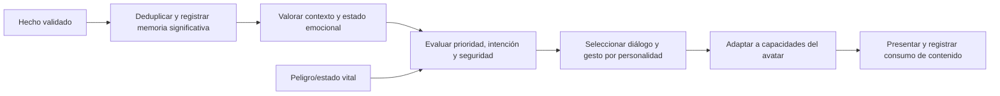

# VRM — Fase 3: personalidad y expresión contextual

**Versión:** 0.1 · **Fecha:** 28/10/2026. **Estado:** BORRADOR / PROPUESTA, NO AUTORIZA IMPLEMENTACIÓN.  
**Preparación autorizada:** [DEC-007](../DECISIONS.md). **Dependencia:** [F2 estable](VRM_Fase2_Contrato_Funcional_v0.1.md) y revisión del siguiente hito por Chat 1.  
**Visión:** [GDD v0.5 §§1, 4, 6–7, 10–12](../GameDesignDocument_v0.5.md), [VRM v0.2](Sistema_Companera_VRM_v0.2.md).  
**Trazabilidad:** [matriz F2/F3](VRM_F2_F3_Matriz_Trazabilidad_v0.1.md). No se escriben código ni escenas.

## 1. Objetivo y alcance de diseño

La compañera interpreta acontecimientos, conserva experiencias y elige respuestas que expresan su identidad. Las expresiones VRM son un canal de salida; el avatar no decide si hay confianza, gratitud, temor o desacuerdo.

Preparar una primera secuencia verificable: rescate inicial → charla segura → promesa aceptada → cumplimiento o incumplimiento → reacción recordada, con peligro que interrumpe la conversación y una pequeña iniciativa voluntaria. Son ejercicios de validación de las mecánicas ya previstas, no la historia completa.

Mantener prólogo de trampa de bandidos, supervivencia, autonomía, combate por clase, convivencia, progresión, amistad desarrollada y romance opcional. No implementar todo simultáneamente ni declarar estas áreas completas por superar esta secuencia.

## 2. Seis capas que no deben confundirse

| Capa | Datos / duración | Regla |
|---|---|---|
| Emoción | Alegría, preocupación, enfado, miedo o alivio; intensidad, causa y vigencia contextual | Transitoria; perder un morph no borra emoción. No leerla desde el peso de happy |
| Rasgos estables | Plantilla tsundere/yandere/tímida y tendencias de reserva, franqueza, atención y autonomía | No cambiar de arquetipo por una emoción o recompensa. Evolución gradual documentada |
| Memoria | Hecho, participantes, contexto, evaluación, marca temporal/estado y unicidad | Conservar acontecimientos significativos; no almacenar cada frame como recuerdo |
| Intención | Alertar, agradecer, objetar, pedir aclaración, proponer pausa, cooperar o esperar ocasión | Decidida según hechos, seguridad, objetivo, personalidad, recuerdos y relación |
| Diálogo/gesto | Clave de contenido, variantes, destinatario, gesto semántico y estado de conversación | Puede expresar la misma emoción de forma distinta; sin registrar de nuevo el hecho al decir una línea |
| Salida visual | Presets/custom disponibles, mezcla y exclusiones, mirada y canal alternativo | Adaptar intención a capacidades probadas del VRM; nunca emitir un evento de confianza por activar una cara |

Clase, salud/estado vital y relación son entradas independientes. La apariencia no modifica la valoración de un hecho, la inteligencia o la propensión romántica. La experiencia puede mejorar destreza e iniciativa de una tímida sin borrar su reserva.

## 3. Hechos y datos mínimos propuestos

Eventos son hechos ocurridos, no botones faciales. Nombres siguientes son etiquetas de diseño, no clases runtime obligatorias.

| Hecho | Fuente válida / datos esenciales | Efecto permitido |
|---|---|---|
| Rescate inicial completado | Resultado de interacción con trampa; evento estable, ID compañera y encuentro | Memoria única del rescate, alivio/gratitud y confianza inicial según regla existente; sin romance |
| Promesa aceptada | Elección explícita y confirmada, objeto/alcance, condición de cumplimiento y cierre | Memoria pendiente; una frase casual o ejemplo del creador no la crea |
| Promesa cumplida | Evidencia de misión/interacción que satisface la condición | Cerrar pendiente una vez, actualizar valoración y ofrecer reconocimiento |
| Promesa incumplida | Condición acordada comprobablemente fallida o abandono explícito | Cerrar como incumplida y permitir desacuerdo/reparación; no deducirlo solo del silencio o menú |
| Peligro detectado/cesado | Percepción/estado de juego fiable, ubicación y urgencia | Suspender charla, alertar/actuar; evaluar relevancia al volver a seguro |
| Momento seguro disponible | Sin peligro ni interacción prioritaria, contexto y actividad | Considerar iniciativa; no obliga a hablar a intervalos fijos |
| Interacción resuelta | Aceptación/rechazo/fin de diálogo o propuesta | Marcar contenido escuchado, regular repeticiones y cerrar intención si corresponde |
| Representación cambiada | Confirmación del sistema visual F2 | Recalcular presentación desde misma emoción; sin nueva memoria narrativa ni evento de relación |

Un evento necesita ID estable, tipo, origen, participantes, contexto/encuentro, tiempo de juego relevante y payload validado. Persistir IDs significativos y consumidos para evitar duplicados al cargar/repetir checkpoint. No usar reloj del sistema ni tiempo pasado en pausa para declarar una promesa incumplida. Los plazos y efectos numéricos de promesas siguen como parámetros pendientes, no una regla nueva aprobada.

La memoria de rescate debe reconciliar el booleano existente RemembersFirstRescue y el evento previsto FirstRescue_BanditTrap. Migrar una bandera verdadera no añade otra recompensa. El Trust=1 del primer rescate actual es antecedente del prototipo, no autorización de una economía completa de confianza.

## 4. Flujo de decisión propuesto

1. Validar hecho y destinatario. Un evento duplicado puede refrescar lectura del estado, pero no aplica otra recompensa ni crea otra promesa.
2. Actualizar memoria/estado del acontecimiento de forma consistente. La presentación pendiente no impide recordar que ocurrió.
3. Evaluar emoción con causa: ayuda → alivio/gratitud; riesgo → preocupación/miedo; promesa rota → decepción/molestia contextual. No todas las personas ni eventos producen igual intensidad.
4. Elegir intención según prioridad y oportunidad. Una compañera puede disentir o aplazar una charla aunque esté agradecida.
5. Seleccionar una variante local no repetida cuando exista; si no hay variante nueva, no inventar texto ni forzar conversación.
6. Ejecutar gesto seguro y expresión disponible; medir legibilidad. Guardar qué se presentó sin volver a aplicar el efecto de relación.
7. Cuando desaparece la causa o cambia contexto, atenuar/revalorar emoción; no acumular permanentemente todos los canales.

Esto describe comportamiento, no prescribe un nuevo event bus, motor de IA o número de componentes. Reutilizar la separación y piezas del proyecto tras inspección. Todo el contenido y reglas funcionan offline con datos locales, sin modelos de lenguaje, MCP ni APIs externas.

## 5. Interrupción, colas e iniciativa

Prioridad del GDD: supervivencia > combate > interacción importante > movimiento > gestos sociales > ambiente. Peligro útil puede interrumpir. No interrumpir un rescate con una frase de gratitud ni hacer que una animación social impida moverse.

Estado de intención: propuesta → en espera segura → presentándose → resuelta/cancelada. Un peligro suspende conversación, limpia la comedia, conserva el hecho/memoria y habilita alerta/acción táctica. Al volver a seguro, reevaluar: retomar un tema importante si aún tiene sentido; descartar comentarios ambientales caducados. No reiniciar siempre desde la primera línea ni completar una frase sin el interlocutor.

Los límites de frecuencia, tiempos de espera y caducidad se configuran por contenido y contexto; valores concretos pendientes de prueba. Hay una intención conversacional activa y alternativas pendientes acotadas; no colas ilimitadas de avisos. Pausa no cuenta como ausencia, abandono ni incumplimiento.

**Pequeña iniciativa candidata:** en un tramo seguro, tras observar el entorno y si no hay otra interacción, propone mirar el camino o comentar una pista ya percibida. Puede ser aceptada o rechazada sin castigo automático; no inventar una misión, peligro o preferencia a partir de la nada. Debe ser útil al contexto y tener criterio de no repetición.

## 6. Matriz de las tres personalidades

Misma apariencia, clase, hechos y relación previa en todas las columnas. Los textos son muestras pendientes de revisión, no reglas de personalidad completas.

| Situación / emoción e intención común | Tsundere | Yandere | Tímida |
|---|---|---|---|
| Primer rescate: alivio + agradecer con cautela | “Ya estaba buscando cómo salir… Gracias. ¿También vas a la aldea?” Postura firme, aparta mirada un instante | “Te detuviste al oírme. Gracias. Prefiero que salgamos de este sendero.” Atención sostenida, sin enamoramiento | “Gracias… Ya puedo respirar. ¿Me ayudas a llegar al camino?” Gesto contenido, recupera mirada |
| Promesa aceptada: expectativa + confirmar alcance | “De acuerdo. Pero avísame si cambias de plan.” Objeción práctica y asentimiento breve | “Entonces lo recordamos los dos. Avísame si algo cambia.” Atención y pausa | “Está bien… Me ayuda saberlo.” Asentimiento y voz clara |
| Promesa cumplida: alegría + reconocer | “Cumpliste. Sabía que podías… Bueno, gracias.” Sonrisa breve, postura menos tensa | “Lo recordaste. Me alegra poder contar contigo.” Sonrisa abierta y alivio | “Te acordaste… Gracias. Yo también quiero ayudarte.” Sonrisa y contacto visual algo mayor |
| Promesa incumplida: decepción + disentir/reparar | “Habíamos acordado otra cosa. ¿Qué ocurrió?” Mirada directa, sin insultar | “Esperaba que me avisaras. Quiero entender qué cambió.” Tensión y preocupación, sin sabotaje o castigo celoso | “No era lo que habíamos quedado… Necesito que lo hablemos.” Gestos pequeños, objeción firme |
| Riesgo cercano: preocupación + alertar/protegerse | “¡Cuidado! No avances sin mirar.” Movimiento listo, sin fingir invulnerabilidad | “Hay movimiento. Quédate atento; voy a cubrir este lado.” Foco táctico, sin obediencia ciega | “Espera, he oído algo a la izquierda.” Puede hablar con claridad ante peligro |
| Fin de peligro: alivio + retomar según contexto | “Bien. Ahora sí, ¿qué ibas a decir?” Relaja postura | “Ya pasó. Podemos seguir hablando si quieres.” Atención recuperada | “Creo que ya es seguro… Podemos continuar.” Respiración/gesto de alivio |
| Momento seguro: interés + iniciativa | “Voy a mirar ese tramo. Podemos evitar otra trampa.” Motivación práctica | “Recuerdo la pista del camino. ¿La revisamos antes de seguir?” Atención a un hecho real | “He visto una señal junto al sendero… ¿La miramos?” Iniciativa reservada |
| Orden peligrosa: preocupación + desacuerdo | “Así nos van a rodear. Mejor por el otro lado.” Directa | “No me parece seguro. Busquemos una salida antes.” Atenta y autónoma | “Prefiero que no entremos todavía. No veo una retirada.” Reservada pero competente |

No equiparar yandere con violencia automática, tsundere con maltrato constante o tímida con incompetencia. La atención intensa y necesidad de seguridad pueden expresarse sin devoción instantánea ni romance forzado. La amistad tiene desarrollo propio.

## 7. Confianza, memoria y evolución

- Un hecho significativo y único puede afectar confianza; repetir una muestra, cargar checkpoint o activar happy no lo hace.
- Distinguir la valoración del acontecimiento de la posibilidad de hablar sobre él; agradecer no exige otorgar puntos otra vez.
- Promesa tiene ciclo pendiente/cumplida/incumplida/reparada con historia, no un booleano borrado al cambiar avatar. La forma de reparación es propuesta narrativa pendiente, no misión nueva autorizada.
- Mantener razones consultables para cambios de confianza. No aumentar vínculo por tiempo inmóvil, pulsar “hablar” repetidamente o instalar otro modelo.
- Aprendizaje por experiencias modifica tendencias gradualmente dentro de su personalidad; no cambiar tsundere→tímida por un umbral arbitrario.
- Misiones personales, preferencias, convivencia y entrenamiento aportarán más fuentes en hitos posteriores. Este borrador no las elimina ni pretende escribirlas todas.
- Romance no deriva de un contador de confianza ni del arquetipo; requiere decisiones recíprocas y contenido propio, conforme al GDD.

## 8. Adaptación visual por avatar

Intenciones semánticas: gratitud, desacuerdo, preocupación, alegría y alerta. Presentador consulta capacidades verificadas, no nombres presumidos. happy para alegría si su prueba funciona; preocupación puede usar sad suave solo si su aspecto corresponde. Si no existe, gesto y texto; si no hay gesto seguro, salida verbal. No crear morphs o retocar texturas arbitrarias.

Surprised normal no equivale a sorpresa cómica. La comedia usa solo recursos certificados o símbolo externo seguro; se omite si no resulta legible y sin doble par de ojos. Peligro limpia efectos cómicos y controla prioridad. Al cambiar VRM, reexpresar la emoción persistente con sus capacidades, sin copiar pesos por índice.

Neutral y alegría deben distinguirse por boca/mejillas/mirada además de texto: neutral sin sonrisa obligatoria; alegría con cambio visible cuando exista el canal. Falta de sonrisa no debe impedir una acción de gratitud.

## 9. Datos locales de contenido propuestos

Cada entrada de respuesta necesita: clave estable, tipo de hecho, condiciones/contexto, personalidad o variante común, intención, emoción/causa, clave de diálogo, gesto semántico opcional, capacidad preferida/alternativa, prioridad, caducidad, grupo de repetición y registro de consumo. Separar estas entradas de eventos de partida y recursos del avatar.

Evitar texto o reglas por nombre de archivo/modelo. Si una expresión personalizada se registra como compatible, pertenecerá al mapa de capacidades del recurso, no a su personalidad. Los números de intensidad, decaimiento, frecuencia y efecto de confianza son parámetros propuestos sin valores finales aprobados.

## 10. Criterios F3 propuestos

Todos pendientes; no se confunden con F2 ni se exigen para declarar importación funcional básica.

| Caso | Resultado a verificar |
|---|---|
| F3-AC01 | Rescate real, repetición de checkpoint y recarga: un recuerdo/efecto inicial, tres reacciones según personalidad, sin romance automático |
| F3-AC02 | Promesa explícita aceptada, cumplida o incumplida por hecho válido: historia persistente y respuesta contextual; silencio/pausa no crean incumplimiento |
| F3-AC03 | Misma situación produce emociones/intenciones coherentes y diferencias de diálogo/gesto en las tres plantillas, sin cambiar cuerpo o clase |
| F3-AC04 | Peligro durante frase/comedia: interrumpir y priorizar supervivencia; al volver, reevaluar tema y no duplicar efectos |
| F3-AC05 | Ventana segura con pista real: iniciativa útil una vez según contexto; rechazarla no causa castigo automático ni repetición inmediata |
| F3-AC06 | Orden peligrosa: objeción con razón y alternativa; una tímida puede disentir y una yandere actuar autónomamente |
| F3-AC07 | Cambiar avatar de expresivo a limitado durante partida segura: mismos hechos/emoción/confianza/intención, presentación alternativa verificable |
| F3-AC08 | Activar pesos faciales desde muestra no emite recuerdos ni confianza; sin morph/gesto, la conducta y el contenido siguen disponibles |
| F3-AC09 | Guardar/reiniciar offline: promesas, recuerdos, consumos y rasgos conservados; versiones/datos inválidos no destruyen la última partida válida |
| F3-AC10 | Batería de la matriz con igual estado y diferentes personalidades; distinguir neutral/alegría y no aceptar una mera alternancia facial como personalidad |

Antes de implementar, Dirección revisa el hito preciso, contenido, valores de ajuste y dependencia F2. Desarrollo entregará evidencia por hecho/estado, decisiones y presentación; una captura de happy no acredita personalidad o memoria.

**Registro 0.1:** preparación documental solicitada por DEC-007. No crea nuevas mecánicas aprobadas, no sustituye el prólogo ni autoriza gameplay por estar en el mismo PR.
